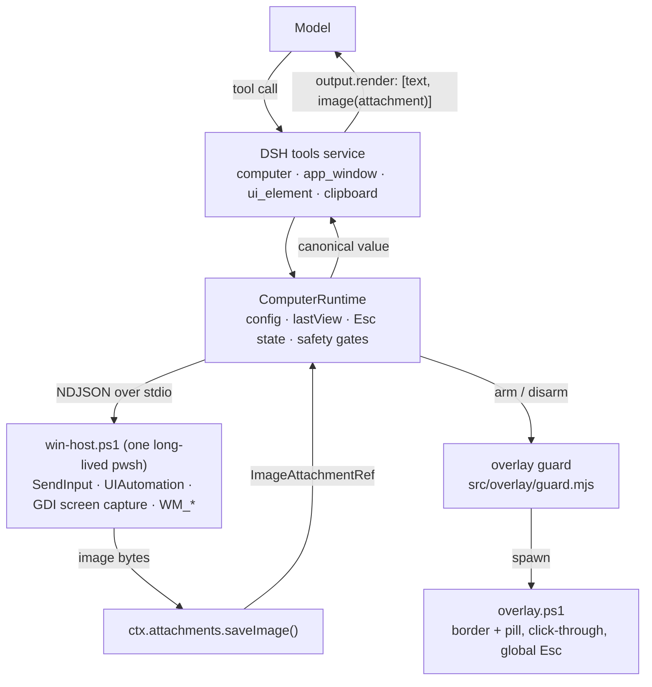

# dsh-computer-use

> **English** · [简体中文](README.zh.md)

**Codex-style computer use for DeepSeek Harness** — let the agent see the real screen and drive the real mouse/keyboard on Windows, with a visible overlay and an Esc kill switch.

`dsh-computer-use` is a DSH plugin bundle. It registers five model-facing tools that operate the actual desktop of the person you are talking to: a `computer` tool mirroring the Codex computer-use action surface, plus `app_window`, `ui_element`, `clipboard` and `app_skill` for the channels that make desktop control reliable without vision.

| | |
|---|---|
| Platform | Windows 10 / 11 (x64) |
| Host services | `tools` (via `inject`) |
| Tools | `computer`, `app_window`, `ui_element`, `clipboard`, `app_skill` |
| Runtime deps | none — Node built-ins only, plus a PowerShell child process |
| Kill switch | global Esc while the overlay is up |
| Package | ESM, `dsh.bundle.patch` → `cordis.patch.yml` |

## Why it looks like this

Five decisions shape the whole plugin. They are deliberate; changing any of them breaks something that is hard to notice until it bites.

1. **One long-lived PowerShell host, not one process per command.** `win-host.ps1` is spawned once (lazily, on the first tool call) and speaks NDJSON over stdin/stdout. `Add-Type`, DPI awareness, the UIAutomation assemblies and the `SendInput` struct layout are paid for exactly once, so a click costs milliseconds instead of a second of PowerShell startup. Nothing is spawned at profile boot: a broken backend cannot break DSH startup, and a profile that merely lists the plugin costs nothing.
2. **Screenshots travel through the DSH attachment pipeline.** The tool result carries an `ImageBlock` holding an **attachment reference** (`ctx.attachments.saveImage()` → `ImageAttachmentRef`), never base64 bytes. The session log stays a few hundred bytes per screenshot and the pixels live in the attachment store. `output.render` returns exactly `[text, image(attachment ref)]`.
3. **Coordinates are in the pixel space of the image the model was handed.** The model reads `x`/`y` off the screenshot it received, so the plugin records that image's geometry (`view.width/height/scale/capture`) and maps back with `physical = capture + image / scale`. Captures are deliberately squeezed to **≤ 600000 pixels** and JPEG-encoded *before* they are attached, because the DeepSeek request path re-projects any image to its own budget (640000 px / 1 MiB). If the plugin let that happen, the model would measure one image and the plugin would click on another, and every click would land a few percent off.
4. **Text-only models are first class.** Every screenshot can carry a UI Automation outline as text (`uiSummary: summary` by default, `tree` for depth), and `ui_element` addresses a control by its accessibility path instead of by pixels. A model that cannot see images at all can still list windows, find a button by its visible label and invoke it. `app_skill` then hands the same model a short per-application recipe — hotkeys, exact menu paths, pitfalls — before it touches the app.
5. **Safety is visible and physical.** A human must be able to see that the machine is being driven, and stop it instantly: a click-through overlay draws a border and a pill while mutating actions run, a global Esc freezes every mutating action (`STOPPED_BY_HUMAN`), `dryRun` logs without touching the OS, `requireApproval` can route each mutation through the DSH approval service, and `blocklist` refuses targets by name.

## Requirements

| Requirement | Notes |
|---|---|
| Windows 10 or 11 | Interactive desktop control is Windows-only. On any other platform the bundle row stays inert (`disabled:` guard in the patch) and no tools are registered. |
| Node.js ≥ 20 | `package.json` declares `engines.node >= 20`. |
| PowerShell 7 (`pwsh`) or Windows PowerShell 5.1 | The host is probed in this order: `$env:DSH_PWSH`, `%ProgramFiles%\PowerShell\7\pwsh.exe`, `%SystemRoot%\System32\WindowsPowerShell\v1.0\powershell.exe`. PS 7 is preferred (STA clipboard, faster `Add-Type`). |
| DSH ≥ 0.1.5 | Verified against `0.1.5-rc.2` / `0.1.5-rc.3`. |
| `pnpm` on `PATH` | Only needed by `dsh plugin add`: the CLI shells out to `pnpm` and exits `127` when it is missing. `scripts/install.ps1` generates a shim for you if you do not want a global install. |

If `pnpm` is missing but DSH's bundled copy is present, these four lines make it available to the current session only (adjust the path to your DSH runtime):

```powershell
$pnpm = "E:\Users\lizhen\.dsh\dsh-runtimes\dsh-primary-runtime\dependencies\pnpm\bin\pnpm.mjs"
New-Item -ItemType Directory "$env:TEMP\dsh-cu-bin" -Force | Out-Null
"@node `"$pnpm`" %*" | Set-Content "$env:TEMP\dsh-cu-bin\pnpm.cmd" -Encoding ascii
$env:PATH = "$env:TEMP\dsh-cu-bin;$env:PATH"
```
## Install

`dsh` does not need to be on `PATH` — `npx @deepseek-ai/dsh ...` works everywhere below. Pick the profile you want the tools in (`web` and `desktop` are the usual ones); the profile lives at `$DSH_HOME\profiles\<name>`.

**1. Add the bundle to a profile.** Use an absolute path; a relative path is anchored to the directory you run the command from.

```powershell
npx @deepseek-ai/dsh plugin --profile web add "file:C:\path\to\dsh-computer-use"
```

`dsh plugin` runs `pnpm` inside the profile directory and then reconciles the profile: because this package declares `dsh.bundle.patch`, `dsh-computer-use` is appended to `dsh.profile.bundles` in `$DSH_HOME\profiles\web\package.json`.

**2. Restart DSH.** The bundle list is resolved at boot, so a new dependency needs a restart. (Edits to `cordis.patch.yml` itself are hot-applied in the `web` profile, but adding the package is not.)

**3. Verify the row is in the composed config.**

```powershell
npx @deepseek-ai/dsh --profile web --dump-config
```

The output is the composed tree with `# ==` provenance comments; it must contain the line `id: computer-use` (under `# == dsh-computer-use`). `--dump-config` is static — it proves the row is mounted, not that tools registered. To prove registration, open a new session and ask the agent to take a screenshot, or run the offline contract test:

```powershell
node test\plugin-selftest.mjs
```

**Other sources, same one line.**

```powershell
# a tarball you built yourself (npm run pack:check builds and validates one)
npm run pack:check
npx @deepseek-ai/dsh plugin --profile web add "C:\path\dsh-computer-use-0.2.0.tgz"

# straight from git
npx @deepseek-ai/dsh plugin --profile web add "github:Iroul1212/DSH-Computer-Use#v0.2.0"

# from npm, once you publish it under a name you own (see Publishing)
npx @deepseek-ai/dsh plugin --profile web add "<your-name>"
```

> The npm name `dsh-computer-use` is already taken by an unrelated package, so this repository does not publish under it. Every option above resolves the module by the name inside the package, so nothing else changes.

**4. Uninstall.**

```powershell
npx @deepseek-ai/dsh plugin --profile web remove dsh-computer-use
```

Then restart DSH. If your `dsh` build does not implement `plugin remove`, delete `dsh-computer-use` from `dependencies` **and** from `dsh.profile.bundles` in `$DSH_HOME\profiles\<name>\package.json`, then run `pnpm install` in that directory.

The repository also ships scripts that do all of this for you — including the `pnpm` shim and the `--dump-config` assertion:

```powershell
pwsh -NoProfile -File scripts\install.ps1 -Profile web
pwsh -NoProfile -File scripts\uninstall.ps1 -Profile web
```

## Quick start

Say these to the agent in a DSH session. The tool sequences are what the plugin's own tool descriptions steer the model into; they are not the only correct paths.

**1. "帮我在记事本里写一段会议纪要" / "Write a short meeting note in Notepad"**

| # | Tool call | Why |
|---|---|---|
| 1 | `app_window` `{ action: "launch", command: "notepad.exe" }` | Starts the app and reports the new window's `hwnd` (or says no window appeared). |
| 2 | `computer` `{ action: "type", text: "...", observe: true }` | Types Unicode text as real keyboard input, then returns a screenshot so the model can verify in the same round trip. |
| 3 | `computer` `{ action: "screenshot" }` | Confirms the text landed, and sets the coordinate space for anything that follows. |

**2. "打开浏览器搜索 DeepSeek Harness" / "Open the browser and search for DeepSeek Harness"**

| # | Tool call | Why |
|---|---|---|
| 1 | `app_window` `{ action: "launch", command: "msedge.exe" }` | Launch (or `list` first if the browser is already open, then `focus`). |
| 2 | `computer` `{ action: "key", keys: ["ctrl", "l"] }` | Focus the address bar — a keyboard path beats clicking an unnamed control. |
| 3 | `computer` `{ action: "type", text: "DeepSeek Harness" }` | Type the query. |
| 4 | `computer` `{ action: "key", keys: ["enter"] }` | Submit. |
| 5 | `computer` `{ action: "screenshot", uiSummary: "tree" }` | Read the result page, with a UI Automation outline as text. |

**3. "把桌面上那个记事本窗口最大化" / "Maximize that window on the desktop"**

| # | Tool call | Why |
|---|---|---|
| 1 | `computer` `{ action: "screenshot" }` | See what is on screen (and record the coordinate space). |
| 2 | `app_window` `{ action: "list", filter: "记事本" }` | Resolve the window to an exact `hwnd` instead of guessing. |
| 3 | `app_window` `{ action: "maximize", hwnd: 1234 }` | A window-management operation, no mouse involved. |
| 4 | `computer` `{ action: "screenshot" }` | Verify the window really is maximized. |

If the target is a control with a visible label rather than a window (`ui_element` `{ action: "find", nameContains: "保存" }` → `ui_element` `{ action: "invoke", path: "0/2/1" }`), the agent will usually prefer that over coordinates: it survives layout changes and works for text-only models.
## Tools

Five tools, **38 actions** in total (`computer` 16, `app_window` 7, `ui_element` 8, `clipboard` 2, `app_skill` 5). Everything a mutating call returns also accepts `observe: true` (append a fresh screenshot) or `verify: true` (take a capture and report whether the screen changed, without attaching pixels). `clipboard` and `app_skill` have neither.

Every tool returns one canonical JSON object. `output.render` turns it into `[text block, optional image block]`, and the image block carries an attachment reference (`image`), never bytes.

### `computer` — the action surface

```jsonc
{ "action": "click", "x": 420, "y": 260 }          // image-space coordinates from the last screenshot
```

| action | Kind | Parameters it uses | Returns |
|---|---|---|---|
| `screenshot` | read | `screen`, `hwnd`, `region`, `maxWidth`, `uiSummary`, `grid`, `gridStep`, `mark`, `dim`, `compare` | `text` (envelope: coordinate mapping factor, cursor in physical and image space, foreground window, UI Automation outline, screen-change verdict), `image` (attachment ref or `null`), `savedPath`, `view` (`width`,`height`,`scale`,`capture`,`screen`,`at`), `cursor`, `change`, `fallback`, `ui` |
| `cursor` | read | — | `cursor` `{x,y}` in physical pixels, plus the same point in the last screenshot's space |
| `status` | read | — | text: host state, overlay visible/hidden, Esc state, dry-run flag, number of mutating actions, coordinate space |
| `move` | **mutating** | `x`, `y` | physical `{x,y}` the pointer was moved to |
| `click` | **mutating** | `x`, `y`, `button`, `count`, `modifiers` | physical `{x,y}`, `count` |
| `double_click` | **mutating** | `x`, `y`, `button`, `modifiers` | same as `click` with `count: 2` |
| `right_click` | **mutating** | `x`, `y`, `modifiers` | same as `click`, right button |
| `middle_click` | **mutating** | `x`, `y`, `modifiers` | same as `click`, middle button |
| `drag` | **mutating** | `x`, `y`, `toX`, `toY`, `button`, `modifiers` | `from` / `to` in physical pixels |
| `scroll` | **mutating** | `x`, `y`, `dy`, `dx`, `modifiers` | physical `{x,y}`, `dy`/`dx` in wheel units (`notches × 120`) |
| `type` | **mutating** | `text` | `chars` typed (UTF-16 code units; one emoji counts as 2) |
| `key` | **mutating** | `keys` | the keys that were pressed |
| `wait` | neutral | `seconds` (0–30, default 1) | text |
| `ocr` | read | `hwnd`, `region`, `lang`, `maxLines` | recognised `lines[]` (`text` + `bounds` in physical pixels), `lang`, `engine`, `elapsedMs` |
| `wait_for` | read | `waitKind` (`stable` / `window` / `element` / `text`), `timeoutMs`, `stableMs`, `hwnd`, `titleMatch`, `name`, `text`, `lang` | `wait` (`kind`, `waitedMs`, `frames`, `ratio`) or `WAIT_TIMEOUT` with a hint about what kept changing |
| `resume` | control | — | clears the Esc kill switch; no-op text when nothing is tripped |

`wait_for stable` does not ask for two byte-identical screenshots - a blinking caret would defeat that. It reuses the frame signature behind `compare` and accepts a frame as quiet when under 0.2% of sampled pixels moved, so "the window has settled" works on real desktops.

Prefix `x`/`y` with nothing: they are always read in the pixel space of the **last screenshot this tool returned**. Omit them to act at the current pointer position. `coordinates: physical` in the config switches them to physical screen pixels.

| Parameter | Type | Required | Meaning |
|---|---|---|---|
| `action` | string, enum of the 14 `computer` actions | **yes** | What to do. |
| `x`, `y` | integer | no | Target point in the last screenshot's space (or physical with `coordinates: physical`). |
| `toX`, `toY` | integer | no | Drag end point, same space as `x`/`y`. |
| `button` | `left` / `right` / `middle` | no | Mouse button for `click` / `drag`. Default `left`. |
| `count` | integer | no | Click count 1–3 (`double_click` implies 2). |
| `modifiers` | array of `ctrl`, `alt`, `shift`, `win` | no | Held during `click`, `drag`, `scroll`, `key`. |
| `text` | string | for `type` | Exact text; Unicode including Chinese and emoji is delivered via `SendInput` + `KEYEVENTF_UNICODE`. |
| `keys` | array of string | for `key` | Chord pressed in order and released in reverse, e.g. `["ctrl","c"]`, `["alt","tab"]`, `["f5"]`. |
| `dy`, `dx` | integer | for `scroll` | Wheel notches; `dy > 0` scrolls up/away from the user, one notch = 120 units, `dx > 0` is right. |
| `seconds` | number | no | Seconds to wait for `wait` (0–30). |
| `screen` | integer | no | Display index from the host's `screens` array. Omit for the primary display. |
| `hwnd` | integer | no | Capture just this window (`PrintWindow`) instead of the whole display. |
| `region` | object `{x,y,width,height}` (all required, integers) | no | Capture a physical-pixel rectangle. |
| `maxWidth` | integer | no | Downscale this capture to at most this width (overrides `screenshot.maxWidth` for one call). |
| `uiSummary` | `none` / `summary` / `tree` | no | UI Automation detail returned as text next to the image. |
| `compare` | boolean | no | Diff this capture against the previous capture of the same target (window / screen) and return a `change` object. |
| `grid` | boolean | no | Draw a labelled coordinate grid over the image. Labels are image-space, so they can be fed straight back to `click`. |
| `gridStep` | integer | no | Grid spacing in image pixels (default ≈ width/10, rounded to 50). |
| `mark` | object `{x,y}` | no | Draw a crosshair at one image-space point — "this is where the next click lands". |
| `dim` | object `{x,y,width,height}` | no | Darken everything outside this image-space rectangle. |
| `verify` | boolean | no | Mutating actions only: take one extra capture afterwards and report `change` without attaching an image. |
| `observe` | boolean | no | Append a fresh screenshot to the result (implies `compare`). |

#### Did it work? `verify` vs `observe`

Every capture refreshes one small signature of its target, so the screenshot the model already looked at is the reference the next action is judged against. That turns the most common failure mode of a desktop agent — clicking, seeing nothing, and clicking again — into a verifiable step:

```jsonc
{ "action": "click", "x": 420, "y": 260, "verify": true }
// -> text: "Clicked left at image (420,260) = physical (1099,680).
//           Screen verdict: NO visible change since the previous capture (0.0% of sampled pixels differ).
//           If this followed an action, that action probably did nothing - re-read the screenshot ..."
```

`verify` costs one capture (~150 ms) and no image tokens; `observe` costs the same capture plus an attached image. Grid and markers are drawn **after** the diff, so a decorated screenshot never counts as "the screen changed", and a decorated frame never becomes the reference.

#### The pointer receipt

`move`, `click`, `drag` and `scroll` return a `pointer` receipt (`{x, y, requestedX, requestedY, drift, landed}`) read back from `GetCursorPos`, and every move is verified: if `SendInput` is accepted but the pointer does not end up where it was sent, the host retries once with `SetCursorPos` and, if that fails too, fails the call with `POINTER_NOT_LANDED` instead of clicking somewhere else. A silent off-target click is the one failure a computer-use agent must never have.

### `app_window` — real windows

| action | Kind | Parameters | Returns |
|---|---|---|---|
| `list` | read | `filter` | `count`, `windows[]` (`hwnd`, `title`, `class`, `pid`, `process`, `bounds`, `clientBounds`, `minimized`, `maximized`, `foreground`, `visible`), foreground first |
| `focus` | read | `hwnd` or `titleMatch` | `window`, `hwnd` — note the host may still lose the foreground lock |
| `launch` | **mutating** | `command`, `args` | `command`, `pid`, `process`, `window`, `windows[]`; says so explicitly when no window appeared |
| `minimize` | **mutating** | `hwnd` or `titleMatch` | `window`, `result` (bounds after the op) |
| `maximize` | **mutating** | `hwnd` or `titleMatch` | same shape as `minimize` |
| `restore` | **mutating** | `hwnd` or `titleMatch` | same shape as `minimize` |
| `close` | **mutating** | `hwnd` or `titleMatch` | same shape; posts `WM_CLOSE` (unsaved work may prompt) |

| Parameter | Type | Meaning |
|---|---|---|
| `action` | string, enum of the 7 actions (required) | What to do. |
| `hwnd` | integer | Window handle from `list`. Preferred over `titleMatch`. |
| `titleMatch` | string | Case-insensitive substring of the title or process name. Must match exactly one window or the call fails with `AMBIGUOUS_WINDOW` and lists the candidates. |
| `filter` | string | `list` only: narrow the listing (e.g. `"chrome"`, `"记事本"`). |
| `command` | string | `launch` only: executable name or full path, spawned directly (not through a shell). |
| `args` | array of string | `launch` only: one entry per argument, no shell quoting needed. |
| `observe` | boolean | Append a fresh screenshot. |

### `ui_element` — Windows UI Automation

`find` accepts a **description**, not an exact name: `{ action: "find", description: "保存" }` ranks every control in the window by name, automationId, value, role and help text, returns the best few with a score and a one-line reason, and draws them **1..N on a screenshot** so a vision model can pick the right one. The matcher is CJK-aware (bigrams, so "保存" hits "保存并关闭"), ignores punctuation and full-width differences, demotes disabled and scrolled-out controls, and understands kind words ("保存按钮" prefers a Button).

```jsonc
{ "action": "find", "description": "the search box", "limit": 3 }
// 1. Group "FileExplorerSearchBox" path=0/2/0/5 score=0.77 - automationId contains the query; image=(789,56)
// 2. ...
// -> act on it by path, or click the image coordinates; pin numbers match this list
```

Pass `nameContains` instead when you want an exact substring filter over every hit (up to 20).

| action | Kind | Parameters | Returns |
|---|---|---|---|
| `tree` | read | `hwnd`, `maxDepth`, `maxNodes` | indented outline, every line ending in `path=0/2/1`; `nodes`, `truncated` |
| `find` | read | `description`, `nameContains`, `role`, `hwnd`, `limit`, `annotate` | ranked `candidates[]` (`path`, `role`, `name`, `value`, `automationId`, `bounds`, `center`, `image`, `score`, `why`), `found`, plus an annotated screenshot when `annotate` is on (default) |
| `invoke` | **mutating** | `path` | `path`, `hwnd`, `result` (bounds) |
| `set_value` | **mutating** | `path`, `value` | same shape |
| `focus` | **mutating** | `path` | same shape |
| `expand` | **mutating** | `path` | same shape |
| `collapse` | **mutating** | `path` | same shape |
| `select` | **mutating** | `path` | same shape |

| Parameter | Type | Meaning |
|---|---|---|
| `action` | string, enum of the 8 actions (required) | What to do. |
| `hwnd` | integer | Target window. Omit for the foreground window. |
| `path` | string | Element path from `tree` / `find`, e.g. `"0/2/1"`. Required by every acting action. |
| `nameContains` | string | `find`: case-insensitive substring over name, value and automationId. |
| `role` | string | `find`: role filter, e.g. `"Button"`, `"Edit"`, `"MenuItem"`, `"ListItem"`. |
| `value` | string | `set_value`: exact text to put into the control. |
| `maxDepth` | integer | Tree depth, default 8 (clamped 1–20). |
| `maxNodes` | integer | Node budget, default 1200 (clamped 1–5000). |
| `observe` | boolean | Append a fresh screenshot. |

Paths are sibling-index chains (`0/2/1`) in the control view and are only valid while the window keeps that layout: after a resize, navigation or repopulation, take `tree` again.

### `clipboard` — plain text only

| action | Kind | Parameters | Returns |
|---|---|---|---|
| `get` | read | — | `length`, `clipboard` (full text), `text` (summary, previewed at 4000 chars when longer than 8000) |
| `set` | **mutating** | `text` | `length` — overwrites the human's clipboard |

| Parameter | Type | Meaning |
|---|---|---|
| `action` | string, `get` or `set` (required) | What to do. |
| `text` | string | `set`: the exact text to place on the clipboard. |

Images and files on the clipboard are neither read nor written. To paste what you set, use `computer` `{ action: "key", keys: ["ctrl","v"] }`.
### `app_skill` — per-app recipes

| action | Kind | Parameters | Returns |
|---|---|---|---|
| `list` | read | `refresh` | `count`, `skills[]` (app names), `text` (the catalog plus the built-in and user directories) |
| `get` | read | `app`, `refresh` | `found`, `app`, `match[]`, `summary`, `chars`, `source` (`builtin` or `user`), `path`, `content` |
| `save` | **mutating** | `app`, `content`, `summary`, `match`, `overwrite` | `app`, `id`, `path`, `chars` — writes `$DSH_HOME\computer-use-skills\<id>.md` atomically |
| `append` | **mutating** | `app`, `content` | `app`, `id`, `path`, `chars` (the merged length) |
| `remove` | **mutating** | `app` | `app` — deletes the user-layer file; a built-in answers `SKILL_BUILTIN` |

| Parameter | Type | Meaning |
|---|---|---|
| `action` | string, `list` or `get` (required) | What to do. |
| `app` | string | App or exe name, case-insensitive (`Excel`, `EXCEL.EXE`, `notepad`). Required by `save` / `append` / `remove`; optional for `get`, which then uses the foreground window of the last screenshot. |
| `content` | string | `save` / `append`: the markdown body. Keep it short — the hotkeys and menu paths that stop the next attempt from going wrong. |
| `summary` | string | `save`: one line shown in the catalog and in the screenshot hint. |
| `match` | array of string | `save`: extra process or exe names that should match this skill, e.g. `EXCEL.EXE`. |
| `overwrite` | boolean | `save`: replace an existing user skill with the same app id. Without it the call fails with `SKILL_EXISTS`. |
| `refresh` | boolean | Re-read the skill directories first, picking up a file that was just edited. A failure to re-read raises `SKILLS_RELOAD_FAILED`. |

`list` and `get` only read local markdown, so they are safe at any time and never touch the desktop. Keep every recipe short: a skill is a nudge, not a manual, and the built-in ones cannot be deleted — only overridden by a user skill with the same `app`. The workflow is the point: when a screenshot envelope contains a line like `App skill available for Excel (...): call app_skill with action "get" and app "Excel" BEFORE driving this app`, call `get` first and act second — the recipe beats guessing coordinates.

## App skills

A vision model can look at Excel and click cell B3. A text model cannot, and even a vision model burns round trips rediscovering that `F12` opens Save As or that `Ctrl+L` reaches the address bar. Those facts are small, stable and application-specific, so they live in markdown files the deployment owns instead of being crammed into the tool prompt.

**Eight built-in recipes ship in `skills/`**: Excel, Word, PowerPoint, Chrome, Explorer, Notepad, VS Code and Windows Terminal — each listing hotkeys, exact menu paths and the pitfalls that break blind clicking.

**Add your own** by dropping a markdown file into `$DSH_HOME\computer-use-skills\` (or wherever `skillsDir` points). A user file whose id matches a built-in overrides it:

```markdown
---
app: MyApp
match: MyApp, myapp.exe, 我的应用
summary: 导出报表、切换视图、常见坑
---
- 打开导出对话框：ctrl+shift+e，不要点工具栏图标（位置会随窗口宽度变化）。
- 切换视图用 alt+1 / alt+2，比在侧边栏里找条目稳。
- 保存前先 ctrl+s 确认没有未保存标记，否则导出对话框会被挡住。
```

- Front matter is `app` (display name and default id), `match` (comma-separated extra names) and `summary` (one line shown in the catalog and in the screenshot hint). Everything after the front matter is the body the model reads.
- One body is capped at **4000 characters** (`MAX_SKILL_CHARS`); longer files are truncated with a marker.
- Matching is case-insensitive and normalizes away `.exe`, spaces, `_` and `-`, then compares against the process name, window title and window class. `EXCEL.EXE`, `Excel` and `excel` all resolve to the same skill.
- `app_skill` `{ "action": "get", "refresh": true }` re-reads both directories, so a human can edit a skill without restarting DSH.
- `skills: false` switches the library off: no skill directory is read and `app_skill` answers that skills are disabled. `skillsHint: false` keeps the library but stops the one-line hint in screenshot envelopes.


### The agent can write skills too

A recipe is worth little if only a human can add it. `save` / `append` / `remove` let the agent turn a run that finally worked into a recipe for the next time:

- `save` writes `$DSH_HOME\computer-use-skills\<id>.md` atomically (`.tmp` + rename), so a crash never leaves half a recipe behind.
- Saving over an existing user skill needs `overwrite: true`, otherwise `SKILL_EXISTS`; `append` extends it instead.
- The 4000-character cap applies to `save` and to the merged result of `append` (`SKILL_TOO_LONG`); oversized content is rejected, not silently cut.
- These three actions are **mutating**: they pass the Esc kill switch, the blocklist and the approval gate, and under `dryRun` they report `[dry run] Would ...` without touching the disk.
- `remove` deletes the user layer only; a built-in answers `SKILL_BUILTIN` — save a user skill with the same `app` to override it instead.
- A skill that was just saved is already matched by the next screenshot hint; after hand-editing a file pass `refresh: true` to re-read the directories.
- With `skills: false` the library has no user directory and every write fails with `SKILLS_READ_ONLY`.


## Configuration

The bundle ships one row in `cordis.patch.yml`; everything else is that row's `config`. These are the keys `src/runtime.js` (`CONFIG_DEFAULTS` + `normalizeConfig`) actually reads. Out-of-range numbers and unknown enum values fall back to the default instead of failing the boot.

| Key | Type | Default | Meaning | Risk |
|---|---|---|---|---|
| `enabled` | boolean | `true` | Master switch. `false` registers no tools at all. | The agent silently has no desktop tools. |
| `screenshot.maxWidth` | integer 64–8192 | `1280` | Width cap applied before the image is attached. | Larger captures cost tokens and can be re-projected by the request layer, which shifts every coordinate. |
| `screenshot.maxPixels` | integer 65536–16777216 | `600000` | Total pixel budget, applied after `maxWidth`. | Keep it at or below the DSH request budget (640000 px). Overshoot and the request layer rescales your image after you recorded its geometry → clicks drift. |
| `screenshot.format` | `jpeg` or `png` | `jpeg` | Encoding of the returned image. | `png` is lossless but often exceeds the 1 MiB request budget and gets recompressed anyway. |
| `screenshot.jpegQuality` | integer 10–100 | `80` | JPEG quality when `format: jpeg`. | Low values make small UI text unreadable. |
| `screenshot.saveToDisk` | boolean | `true` | When no attachment store is present, spill screenshot bytes to `%TEMP%\dsh-computer-use\screenshots` and return `savedPath`. | Screen content persists on disk in the temp directory. |
| `coordinates` | `image` or `physical` | `image` | How `x`/`y` are interpreted: in the last screenshot's pixel space (mapped back through `view.scale`) or as physical screen pixels. | `physical` skips the mapping entirely — useful when the model reads real pixel values, fatal when it guesses. |
| `uiSummary` | `none`, `summary` or `tree` | `summary` | How much UI Automation detail a screenshot returns as text. | `tree` is the most useful for text-only models and the most expensive. |
| `uiSummaryMaxNodes` | integer | `60` | Node/line budget for a `summary` outline. | Too small hides the control you need. |
| `uiSummaryMaxChars` | integer | `4000` | Character budget for the outline text. | Same, in characters. |
| `overlay` | `auto`, `always` or `never` | `auto` | `auto` shows the indicator only while mutating actions run and hides it after `idleDisarmMs`; `always` keeps it up once shown; `never` disables it. | `never` removes the human's only visual cue. The indicator first appears on the first mutating action, not at boot. |
| `overlayOpacity` | number 0.05–1 | `0.85` | Opacity of the border + pill. | Very low values make it easy to miss. |
| `overlayMessage` | string | `DeepSeek Harness is controlling your computer - press Esc to stop` | Text on the pill. (The shipped `cordis.patch.yml` sets a Chinese variant.) | Localisation only. |
| `escStop` | boolean | `true` | Arms the global Esc kill switch while the overlay is up. | `false` means there is no way to interrupt from the keyboard — the overlay also stops listening for Esc. |
| `dryRun` | boolean | `false` | Mutating actions are reported as `[dry run] Would ...` and never reach the OS. | The agent may believe a task succeeded; nothing happened. |
| `requireApproval` | `never` or `mutating` | `never` | Routes each mutating action through the DSH approval service; only an `allowed-once` outcome proceeds. | Asking only means something when the session approval policy is `ask`. With no approval service mounted the action fails with `APPROVAL_UNAVAILABLE` (fail closed). `DSH_PERMISSION_MODE=danger-full-access` pins the policy to `never`, where every ask is rejected — so `mutating` makes every mutating action fail. |
| `allowLaunch` | boolean | `true` | Allows `app_window` `launch`. | The agent can start any executable your user can start. |
| `allowCloseWindow` | boolean | `true` | Allows `app_window` `close`. | The agent can dismiss windows with unsaved work. |
| `skills` | boolean | `true` | Loads the per-app skill library (the built-in `skills/` plus the user directory) and serves it through `app_skill`. | `false` reads no skill files at all; the tool stays registered and reports that skills are disabled. |
| `skillsDir` | string or `null` | `null` → `$DSH_HOME\computer-use-skills` | The writable user layer: a file whose id matches a built-in overrides it, and `app_skill` `save` / `append` / `remove` write here. | Skill bodies are plain local files — whatever is there is handed to the model verbatim, and the process needs write access to this directory. |
| `skillsHint` | boolean | `true` | Adds one `App skill available for X (...)` line to screenshot envelopes when the app in front has a skill. | `false` removes the nudge, so a model may never notice the recipe exists. |
| `actionDelayMs` | integer 0–5000 | `60` | Milliseconds to sleep after a mutating action completes and before the optional `observe` screenshot, giving the UI time to settle before it is captured. | Too small verifies a stale frame (you see the previous state and act on it); too large slows every observe round trip. |
| `requestTimeoutMs` | integer 1000–600000 | `20000` | Per-request timeout for host commands. | Too low fails slow UI Automation walks. |
| `screenshotTimeoutMs` | integer 1000–600000 | `30000` | Timeout for a capture. | Too low fails captures on busy or large desktops. |
| `idleDisarmMs` | integer 0–3600000 | `60000` | With `overlay: auto`, how long after the last mutating action the indicator hides itself. `0` keeps it up. | A long value leaves the pill on screen; a very short one flashes. |
| `blocklist` | array of string | `[]` | Case-insensitive substrings matched against the human-readable label of every mutating action (`app_window close window "1Password" ...`). A match fails with `BLOCKED_TARGET`. | Label matching only — it cannot protect a window whose title the agent never mentions in the label. |

### Overriding the config

Edit your profile's own patch file — `$DSH_HOME\profiles\<name>\cordis.patch.yml` — and target the row by id. The `web` profile hot-applies patch edits, so no restart is needed for a config change:

```yaml
# $DSH_HOME/profiles/web/cordis.patch.yml
- id: computer-use
  config:
    overlay: always
    screenshot:
      maxWidth: 1024
```

**A patch replaces the targeted row's whole `config`; it is not deep-merged.** In the example above the row no longer has `maxPixels`, `format`, `uiSummary`, `dryRun`, … — every key you did not repeat falls back to `CONFIG_DEFAULTS` in `src/runtime.js`, not to the values shipped in this bundle's `cordis.patch.yml`. When you narrow `maxWidth`, repeat the sibling keys you still want (and keep `maxPixels` at 600000 if you care about coordinate accuracy):

```yaml
- id: computer-use
  config:
    overlay: always
    screenshot:
      maxWidth: 1024
      maxPixels: 600000
      format: jpeg
      jpegQuality: 80
```

To disable the row without uninstalling: `- id: computer-use` with `disabled: true` (or `enabled: false` inside `config`).

## Safety model

What is enforced, in the order `beforeMutation` applies it:

| Gate | Behaviour |
|---|---|
| **Esc kill switch** | While the overlay is armed, a global Esc (edge-triggered, polled with `GetAsyncKeyState`, never `RegisterHotKey`, so it does not steal the hotkey from other apps) trips the guard. Every mutating action from then on fails with `STOPPED_BY_HUMAN`. Only `computer` `{ "action": "resume" }` clears it, and only after 5 seconds (`RESUME_TOO_SOON` before that) — the model cannot quietly resume itself. |
| **Overlay** | A click-through, never-focusing, Alt-Tab-invisible WinForms layer with a **blue glow** around the screen edges and a `COMPUTER USE` chip at the top (next to `overlayMessage`), so anyone walking past can see an agent is driving. The pointer is unmistakable too: the system arrow is swapped for a **blue arrow** and a pulsing blue **ring** follows the pointer (`cursor: agent`; `halo` keeps your own arrow; `off` disables both). Mouse events pass straight through (`WS_EX_TRANSPARENT` + `HTTRANSPARENT`), so the indicator can never eat the agent's own clicks, and your cursor scheme is restored whenever the indicator goes away. |
| **Click lands where you aimed** | Synthetic input goes to whatever is under the point *right now*, so a stolen foreground means the click silently hits another app. Before every click/drag/scroll the host is asked `WindowFromPoint`; if that window belongs to a different process than the window the last screenshot was pinned to, the action fails with `CLICK_WRONG_WINDOW` (naming the app that would have received it) instead of clicking blind. Points outside the pinned window are refused with `OUTSIDE_TARGET_WINDOW`, and `app_window focus` verifies it really got the foreground (`FOCUS_REFUSED` after one retry). Configure with `hitTest: fail \| warn \| off`. |
| **Nothing pretends to work** | A drag that is released over a panel, or keystrokes sent while another app holds the foreground, used to come back `ok: true` while nothing happened. Each drag/type now pays for one frame diff plus the live foreground window: no visible change → `DROP_MISSED` / `TYPE_MISSED`, keys that went to another app → `KEY_MISSED` (a deliberately no-op key such as `ctrl+c` is still fine). Tune with `verifyActions: fail \| warn \| off`. |
| **Unexpected death freezes too** | If the overlay process dies unexpectedly (not an Esc, not a normal disarm) the kill switch is set to `guard-exited`; if the automation host process dies unexpectedly it is set to `host-exited`. Either way every mutating action fails closed immediately, while read-only work still runs (screenshot, status, `app_window` `list`, `ui_element` `tree`), and recovery requires an explicit `resume` — with the same 5 second cooldown, so the human sees the message first. |
| **What `overlay: always` means** | Every desktop call lights the indicator, including read-only ones (`screenshot`, `cursor`). The default, `auto`, lights it only while mutating actions run and hides it again after `idleDisarmMs` of idleness. |
| **Stale observations are refused** | When a screenshot was pinned to one window (`computer` with `hwnd`), every mutating action first re-checks that window: gone → `TARGET_WINDOW_GONE`, now owned by a different pid (the app restarted) → `TARGET_WINDOW_CHANGED`, moved or resized at all → `TARGET_WINDOW_MOVED`. Nothing is performed in any of those cases; take a fresh screenshot and re-derive the target. |

| **Blocklist** | Checked before approval and before dry run. Matches the action's human label case-insensitively; a hit is `BLOCKED_TARGET`. |
| **Approval** | With `requireApproval: mutating`, `ctx.approval.request({agent, toolName, callId, reason, signal})` is asked and only `allowed-once` proceeds. Everything else — including a missing approval service — fails closed. This only buys safety when the session approval policy is `ask`; a policy of `never` (`DSH_PERMISSION_MODE=danger-full-access`) rejects every ask. |
| **Dry run** | After the gates above: returns `[dry run] Would …`, records the intent, and sends nothing to the OS. |

### Privacy mask

`maskRegions` (physical-pixel rectangles, set by the deployment, never by the model) are painted out of **every** capture before it is diffed, decorated or encoded: the attachment the model sees, the frame signature behind `compare`/`verify`/`wait_for stable`, and the PNG that the OCR engine reads all see solid black there. A masked capture says so in its text (`N privacy-masked regions are blacked out`) so the model knows why something is invisible, and `masked: null` on a call cannot turn it off — the runtime injects the mask at the single choke point every screenshot passes through.

```yaml
maskRegions:
  - { x: 0, y: 1180, width: 2560, height: 120 }   # e.g. a password-manager bar
```

Use it for notification popups, chat sidebars, terminals with secrets, or any window you keep visible while the agent works. It hides pixels from the *model*; it does not stop the agent from typing into or clicking a masked area.

Mutating actions (they pass all of the above): `move`, `click`, `double_click`, `right_click`, `middle_click`, `drag`, `scroll`, `type`, `key`; `app_window` `launch`, `close`, `minimize`, `maximize`, `restore`; `ui_element` `invoke`, `set_value`, `focus`, `expand`, `collapse`, `select`; `clipboard` `set`. Reads that never mutate: `screenshot`, `cursor`, `status`, `wait`, `resume`, `app_window` `list` / `focus`, `ui_element` `tree` / `find`, `clipboard` `get`.

### What it does not protect

Be explicit with your users about all of this:

- **It is not a sandbox.** The host process runs at *your* integrity level with *your* token. Every window you can click, the agent can click. The blocklist is a guard-rail against accidents, not a security boundary.
- **UAC secure desktop, the lock screen and higher-integrity windows are out of reach** — and the overlay is invisible there. A non-elevated agent cannot drive an elevated window; it will appear to "do nothing".
- **Full-screen exclusive games and some anti-cheat overlays** hide the indicator (DWM composition is bypassed). The Esc kill switch is also polled by a user-level process and can be starved by the same game.
- **Screenshots leave your machine.** Every capture is attached to the session and sent to the model provider. Passwords, private messages, tokens and customer data visible on screen go with it. Close or minimise what must not be seen, and consider `blocklist` plus a dedicated desktop.
- **Clipboard contents are readable and overwritable** by the agent.
- **A tripped kill switch only stops the agent, not what it already started** — a launched process keeps running.
## How it works



```
DSH host process (Node)
├── src/index.js          plugin entry: named exports { name, inject, apply }
├── src/tools.js          5 tool factories: schema + execute + render
├── src/skills.js         per-app skill library: front-matter parser + SkillStore
├── skills/               8 built-in app recipes (excel, word, powerpoint, chrome, explorer, notepad, vscode, terminal)
├── src/runtime.js        ComputerRuntime: config, coordinate mapping, gates, attachment, UI summary
├── src/win/backend.mjs   WinHost client: spawn once, NDJSON, serial queue, 1 auto-restart
├── src/win/win-host.ps1  the PowerShell host: capture, SendInput, UIA, windows, clipboard
└── src/overlay/
    ├── guard.mjs         Guard: arm/disarm/status, forwards abort → STOPPED_BY_HUMAN
    └── overlay.ps1       WinForms overlay window + Esc poller
```

The loop for one action:

1. The model calls a tool. `execute` builds the value; anything mutating first passes `beforeMutation` (Esc → blocklist → approval → dry run → overlay + idle timer).
2. The runtime sends one NDJSON command to the already-running `win-host.ps1` and waits for the matching `id`.
3. For a screenshot the host returns base64 bytes plus the exact `capture` rectangle and `scale`; the runtime attaches the bytes and records `lastView`, which is what the next coordinate action maps through.
4. `output.render` returns `[{ type: 'text', text }, { type: 'image', attachment }]`. The image block carries a reference — the bytes never enter the session log, and the DeepSeek adapter collects it into the tool-result image path.

`CTRL`-level facts worth knowing: the host runs at your integrity level; the request queue is strictly serial (one desktop action at a time); a crashed host is restarted once and the runtime reports the new state on the next call.

## Troubleshooting

| Symptom / error code | What happened | What to do |
|---|---|---|
| `BACKEND_START_FAILED` | `win-host.ps1` did not announce itself within the ready timeout, or PowerShell could not be started at all. | Run `pwsh -NoProfile -File src\win\win-host.ps1` manually and read stderr; check that PS 7 is installed and that `-ExecutionPolicy` is not blocked by group policy. The runtime error message carries the host's stderr tail. |
| `BACKEND_MISSING` | `src/win/backend.mjs` could not be imported — usually a partially copied package. | Reinstall: the `files` whitelist must include `src`, and the whole `src\win` directory must be present. |
| `NO_REFERENCE_SCREENSHOT` | A coordinate action ran before any screenshot, so image space is undefined. | Call `computer` `{ "action": "screenshot" }` first. Or set `coordinates: physical` and pass real screen pixels. |
| `STOPPED_BY_HUMAN` | A human pressed Esc. Every mutating action is frozen by design. | Stop, report what you were doing and what is on screen, and wait. Call `computer` `{ "action": "resume" }` **only** when the human explicitly says to continue. |
| `RESUME_TOO_SOON` | `resume` was called less than 5 seconds after the Esc press. | Ask the human first, then retry — the delay exists so the agent cannot immediately undo a human stop. |
| `BLOCKED_TARGET` | The action label matched an entry in `blocklist`. | This is the deployment's decision, not a bug. Stop and tell the human; do not try to reach the same target another way. |
| `APPROVAL_UNAVAILABLE` / `APPROVAL_DENIED` | `requireApproval` is on but the approval service is missing or the human declined. | Nothing was performed. Ask the human to approve, or operate differently. |
| Overlay does not appear | `overlay: never`; the guard failed to load (look for `overlay guard unavailable` in the log); the overlay process died (`overlay-exited`); or a full-screen exclusive app is covering it. | Check `computer` `{ "action": "status" }` (`overlay: visible/hidden`), set `overlay: always`, and test the overlay alone: `pwsh -NoProfile -File src\overlay\overlay.ps1 -SelfTest`. |
| Clicks land slightly off target | The model measured one image but the plugin mapped another: usually `screenshot.maxPixels` above the request budget, or a stale `lastView` after a display change. | Keep `maxPixels` at 600000 (and `maxWidth` at 1280 or less), retake a screenshot before the click, or pass `coordinates: physical` and use real pixels. Prefer `ui_element` for anything with a name. |
| Chinese / emoji cannot be typed | The host must use `SendInput` + `KEYEVENTF_UNICODE`; some targets (games, remote sessions, UWP text boxes) swallow injected Unicode. | Verify with Notepad first. If the target ignores injected input, set the text on the clipboard (`clipboard` `{ "action": "set" }`) and paste with `computer` `{ "action": "key", "keys": ["ctrl","v"] }`. |
| `PATTERN_UNSUPPORTED` / `ELEMENT_NOT_FOUND` | The control has no such UI Automation pattern, or the path is stale. | Take `ui_element` `{ "action": "tree" }` again and use a fresh path; fall back to `computer` coordinates. |
| `AMBIGUOUS_WINDOW` | `titleMatch` matched several windows. | Pass the exact `hwnd` from `app_window` `{ "action": "list" }`. |
| `TARGET_WINDOW_GONE` | The window the screenshot was pinned to no longer exists. | Nothing was performed. Take a fresh screenshot and act on what is actually there. |
| `TARGET_WINDOW_CHANGED` | The hwnd now belongs to a different process — the app was restarted. | Nothing was performed. Take a fresh screenshot; the old coordinates are meaningless. |
| `TARGET_WINDOW_MOVED` | The window moved or was resized since the screenshot. | Nothing was performed. Take a fresh screenshot, then act. |
| Bundle installed but no tools appear | `dsh plugin add` and the running DSH resolved **different `DSH_HOME`** values, so the plugin landed in a different profile directory. The desktop app and the CLI can disagree (on this machine: `E:\Users\lizhen\.dsh` for the desktop build, `C:\Users\lizhen\.dsh` for the CLI). | Point `DSH_HOME` at the home of the DSH you are actually using, reinstall, then confirm with the same build and its own `--dump-config`. |

## Testing

Seven Node suites. No build step, no global install:

```powershell
npm test                      # all seven suites
npm run test:schema           # tool definitions inside the JSON Schema subset the host enforces (runs the validator shipped with the host)
npm run test:plugin           # plugin entry + the 5 registered tools + a real screenshot and window listing
npm run test:skills           # 15 assertions on the writable user layer (save / append / remove / overwrite / caps) against a temp directory
npm run test:safety           # the 10 safety contracts (dry run / overlay / Esc / resume cooldown / blocklist / guard-exited and host-exited fail closed)
npm run test:overlay          # overlay child process + a real injected Esc (SKIPs when the desktop swallows synthetic input)
npm run test:observe          # grid / mark / dim, the frame diff behind compare+verify, and the POINTER_NOT_LANDED fail-closed path
npm run smoke                 # 11-step end-to-end exercise of the Windows host (screenshot / Chinese input / window ops / timing)
```

| Suites | Prerequisites |
|---|---|
| `test:schema` | The host package. SKIPs when it cannot be located; set `DSH_TOOLS_PATH` to point at it explicitly. |
| `test:plugin`, `test:safety`, `test:overlay`, `smoke` | A real, interactive Windows desktop session. On a non-interactive session (service, SSH, CI) they SKIP or fail, because they move the real pointer and take real screenshots. |
| `test:skills` | Node only. Every assertion runs against a temporary directory, so your real `$DSH_HOME` is never touched. |

## Known limitations

- **A text-only model cannot see pixels.** It works only through `uiSummary` outlines, `ui_element` paths and window metadata. Anything canvas-drawn (games, image editors, custom-rendered apps) is effectively invisible to it.
- **DPI and multiple monitors.** The host is per-monitor DPI aware and works in virtual-screen physical pixels, so mappings stay correct, but: the overlay draws one border around the whole virtual screen rather than one per display, `screenshot` captures a single display or rectangle at a time, and moving a window between displays with different scale factors invalidates the previous `lastView` — retake a screenshot.
- **Elevation.** A normal-integrity agent cannot drive an elevated window; it will click "through" it or appear to do nothing. For the same reason the overlay is invisible on the UAC secure desktop.
- **Full-screen exclusive content** (DirectX exclusive fullscreen, some anti-cheat protected games) hides the overlay and may swallow injected input; the Esc kill switch is a user-level poller and can be starved too. Windowed/borderless fullscreen is fine.
- **Every screenshot costs a round trip and money.** A capture is a real GDI screen grab, a JPEG encode, an attachment write and then image tokens on the wire. Prefer `observe: true` on the action you were going to verify anyway, and prefer `ui_element` when a control has a name.
- **One desktop, one model.** There is one runtime per plugin instance and one host process; concurrent sessions in the same profile share it (and share `lastView`).
- **Clipboard is plain text only.** Images and file lists are neither read nor written.
- **`actionDelayMs` only covers the settle window.** It is a pause between an action and its `observe` screenshot; it does not make a slow application finish faster.

- **`resume` is a model-callable action.** After an Esc the model is expected to wait until the human explicitly asks it to continue; the 5 second cooldown is a speed bump, not a guarantee, and nothing stops a model that ignores the instruction. For a hard stop, close the DSH session, or disable the plugin (`- id: computer-use` with `disabled: true`) or uninstall it.
- **Skills are plain markdown on your disk, and the model can write them.** That is the point — a successful run becomes a recipe — but it also means a wrong or over-general recipe can be saved and then quietly applied to later work. The user layer is just files under `$DSH_HOME\computer-use-skills`: delete one, or call `app_skill` with `remove`, and the built-in (or the previous behaviour) comes back.

## Publishing

`npm run pack:check` is the gate: it builds the exact tarball `npm publish` would upload, asserts the manifest, every runtime script, both READMEs and the built-in skills are inside it, and imports the packed entry from an unpacked copy to prove it still boots. It also fails loudly if `cordis.patch.yml`'s `name:` drifts from `package.json`'s `name`, because that pair is what makes `dsh plugin add` resolvable.

```powershell
npm pkg set name=dsh-computer-use-<yourhandle>   # or @yourscope/dsh-computer-use
npm login
npm run release                                   # pack:check, then npm publish --access public
npx @deepseek-ai/dsh plugin --profile web add "<the same name>"
```

`prepack` runs the two offline suites (schema contract + matcher), so a broken tool definition cannot be published by accident.

## Development

```powershell
node test\plugin-selftest.mjs    # offline contract checks + a real screenshot/window smoke test
node test\overlay-selftest.mjs   # arms the overlay and injects a real Esc
node test\smoke-win.mjs          # end-to-end host exercise
```

`test\plugin-selftest.mjs` needs no profile and touches nothing.

## License

MIT.
