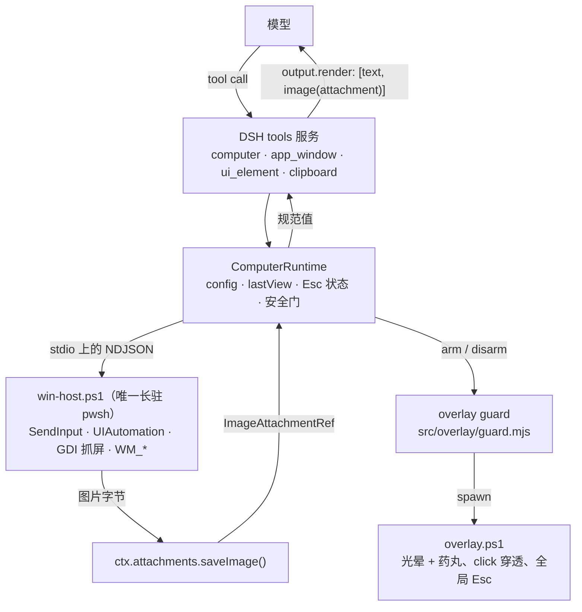

# dsh-computer-use

**Codex 风格的 computer use for DeepSeek Harness** —— 让 agent 看见真实屏幕、驱动真实的鼠标键盘，并且始终有可见 overlay 与 Esc 急停。

`dsh-computer-use` 是一个 DSH 插件 bundle。它注册五个面向模型的工具，用来操作你正在对话的这台真实桌面：`computer` 对齐 Codex 的 computer-use 动作面，另外四个（`app_window`、`ui_element`、`clipboard`、`app_skill`）补上"没有视觉也能可靠控制桌面"所必需的信道。

| | |
|---|---|
| 平台 | Windows 10 / 11（x64） |
| 依赖的宿主服务 | `tools`（通过 `inject`） |
| 工具 | `computer`、`app_window`、`ui_element`、`clipboard`、`app_skill` |
| 运行时依赖 | 无 —— 只用 Node 内建模块，外加一个 PowerShell 子进程 |
| 急停 | overlay 在屏时全局 Esc |
| 包形状 | ESM，`dsh.bundle.patch` → `cordis.patch.yml` |

## Why it looks like this（设计取向）

整个插件由五个决定塑造。它们都是刻意的；改动任何一条，都会坏掉某个"直到踩上去才会发现"的东西。

1. **一个长驻 PowerShell 宿主，而不是每条命令起一个进程。** `win-host.ps1` 只 spawn 一次（懒启动，第一次 tool call 时才起），通过 stdin/stdout 讲 NDJSON。`Add-Type`、DPI 感知、UIAutomation 程序集、`SendInput` 结构体布局都只付一次代价，所以一次 click 是毫秒级，而不是 PowerShell 启动的一秒。**boot 期什么都不启动**：后端坏掉不会拖垮 DSH 启动，只是把插件列进 profile 也几乎零成本。
2. **截图走 DSH 附件管线。** tool result 里放的是携带**附件引用**（`ctx.attachments.saveImage()` → `ImageAttachmentRef`）的 `ImageBlock`，永远不是 base64。session log 里一张截图只有几百字节，像素本体在 attachment store 里。`output.render` 只输出 `[text, image(attachment ref)]`。
3. **坐标按"交给模型的那张图"的像素算。** 模型是从它收到的那张截图上读 `x`/`y` 的，所以插件记录那张图的几何信息（`view.width/height/scale/capture`），再用 `physical = capture + image / scale` 换回物理像素。截图在附加之前就被刻意压到 **≤ 600000 像素**并编码成 JPEG，因为 DeepSeek 请求侧还会把任何图重新投影到它自己的预算（640000 像素 / 1 MiB）。若放任那一步发生，模型量的是 A 图、插件点的是 B 图，每一次 click 都会系统性偏几个百分点。
4. **纯文本模型也是一等公民。** 每张截图都可以附一段 UI Automation 文本大纲（`uiSummary: summary` 是默认值，`tree` 更细），`ui_element` 用可访问性路径而不是像素来定位控件。完全看不见图的模型，照样能列窗口、按可见文字找到按钮并 invoke；`app_skill` 还会在它动手之前，把一份按应用写好的配方（快捷键、确切菜单路径、坑）交给它。
5. **安全是看得见、摸得着的。** 人类必须能看见"机器正在被操控"，并且能立刻打断：click 穿透的 overlay 在 mutating 动作期间画出边框和药丸提示，全局 Esc 冻结之后所有 mutating 动作（`STOPPED_BY_HUMAN`），`dryRun` 只记录不碰系统，`requireApproval` 可以把每一次 mutation 送去 DSH 的审批服务，`blocklist` 按名字拒绝目标。

## Requirements（环境要求）

| 要求 | 说明 |
|---|---|
| Windows 10 或 11 | 交互式桌面控制只在 Windows 上成立。其它平台上这一行 bundle 保持 inert（patch 里的 `disabled:` 守卫），不注册任何工具。 |
| Node.js ≥ 20 | `package.json` 声明 `engines.node >= 20`。 |
| PowerShell 7（`pwsh`）或 Windows PowerShell 5.1 | 宿主按这个顺序探测：`$env:DSH_PWSH`、`%ProgramFiles%\PowerShell\7\pwsh.exe`、`%SystemRoot%\System32\WindowsPowerShell\v1.0\powershell.exe`。首选 PS 7（STA 剪贴板、`Add-Type` 更快）。 |
| DSH ≥ 0.1.5 | 实测版本 `0.1.5-rc.2` / `0.1.5-rc.3`。 |
| `pnpm` 在 `PATH` 上 | 只有 `dsh plugin add` 需要：该命令内部 spawn `pnpm`，找不到就 `exit 127`。若不想全局安装，`scripts/install.ps1` 会替你生成 shim。 |

若 `pnpm` 缺失、但 DSH 自带的那份还在，下面四行可以只对当前会话生效（路径按你的 DSH 运行时调整）：

```powershell
$pnpm = "E:\Users\lizhen\.dsh\dsh-runtimes\dsh-primary-runtime\dependencies\pnpm\bin\pnpm.mjs"
New-Item -ItemType Directory "$env:TEMP\dsh-cu-bin" -Force | Out-Null
"@node `"$pnpm`" %*" | Set-Content "$env:TEMP\dsh-cu-bin\pnpm.cmd" -Encoding ascii
$env:PATH = "$env:TEMP\dsh-cu-bin;$env:PATH"
```
## Install（安装）

`dsh` 不需要在 `PATH` 上 —— 下面所有地方用 `npx @deepseek-ai/dsh ...` 都能调起。先想清楚要装进哪个 profile（常见是 `web` 和 `desktop`），profile 目录是 `$DSH_HOME\profiles\<name>`。

**1. 把 bundle 加进 profile。** 用绝对路径；相对路径会按你执行命令时所在目录锚定。

```powershell
npx @deepseek-ai/dsh plugin --profile web add "file:C:\path\to\dsh-computer-use"
```

`dsh plugin` 会在 profile 目录里跑 `pnpm`，然后做一次 reconcile：因为这个包声明了 `dsh.bundle.patch`，`dsh-computer-use` 会被追加到 `$DSH_HOME\profiles\web\package.json` 的 `dsh.profile.bundles` 里。

**2. 重启 DSH。** bundle 列表是 boot 期解析的，新增依赖必须重启。（`cordis.patch.yml` 的改动在 `web` profile 里是热应用的，但加包不是。）

**3. 验证这一行确实进了合成后的配置。**

```powershell
npx @deepseek-ai/dsh --profile web --dump-config
```

输出是带 `# ==` 来源注释的合成树，里面必须出现 `id: computer-use` 这一行（位于 `# == dsh-computer-use` 之下）。注意 `--dump-config` 是静态合成 —— 它只证明这一行挂上了，不证明工具注册成功。要证明注册，开一个新会话让 agent 截一张图，或者跑离线契约测试：

```powershell
node test\plugin-selftest.mjs
```

**其他安装来源，同样一行。**

```powershell
# 自己打的 tarball（npm run pack:check 会顺手打一个并校验）
npm run pack:check
npx @deepseek-ai/dsh plugin --profile web add "C:\path\dsh-computer-use-0.2.0.tgz"

# 直接从 git
npx @deepseek-ai/dsh plugin --profile web add "github:<owner>/dsh-computer-use#v0.2.0"

# 发布到你自己的 npm 名字之后（见下面的「发布」）
npx @deepseek-ai/dsh plugin --profile web add "<your-name>"
```

> npm 上的 `dsh-computer-use` 已被一个无关的包占用，所以本仓库不用这个名字发布。上面每一种方式都是按包内的模块名解析的，其余步骤完全一样。

**4. 卸载。**

```powershell
npx @deepseek-ai/dsh plugin --profile web remove dsh-computer-use
```

然后重启 DSH。如果你的 `dsh` 版本没有实现 `plugin remove`，就手工从 `$DSH_HOME\profiles\<name>\package.json` 的 `dependencies` **和** `dsh.profile.bundles` 里删掉 `dsh-computer-use`，再在该目录里跑一次 `pnpm install`。

仓库里还带了脚本，把上面这些（包括 pnpm shim 和 `--dump-config` 断言）一次做完：

```powershell
pwsh -NoProfile -File scripts\install.ps1 -Profile web
pwsh -NoProfile -File scripts\uninstall.ps1 -Profile web
```

## Quick start（三个真实用法）

在 DSH 会话里直接这么说就行。下面的 tool call 序列是插件自己的工具描述会把模型带向的路径，不是唯一的正确解。

**1.「帮我在记事本里写一段会议纪要」**

| # | tool call | 为什么 |
|---|---|---|
| 1 | `app_window` `{ action: "launch", command: "notepad.exe" }` | 启动程序并回报新窗口的 `hwnd`（没出现窗口会明说）。 |
| 2 | `computer` `{ action: "type", text: "...", observe: true }` | 用真实键盘输入 Unicode 文本，并顺带返回一张截图，一个来回就能自检。 |
| 3 | `computer` `{ action: "screenshot" }` | 确认文字真的进去了，同时为后续动作设定坐标空间。 |

**2.「打开浏览器搜索 DeepSeek Harness」**

| # | tool call | 为什么 |
|---|---|---|
| 1 | `app_window` `{ action: "launch", command: "msedge.exe" }` | 启动浏览器（已开着就先 `list` 再 `focus`）。 |
| 2 | `computer` `{ action: "key", keys: ["ctrl", "l"] }` | 聚焦地址栏 —— 键盘路径比点一个没有名字的控件可靠。 |
| 3 | `computer` `{ action: "type", text: "DeepSeek Harness" }` | 输入查询词。 |
| 4 | `computer` `{ action: "key", keys: ["enter"] }` | 提交。 |
| 5 | `computer` `{ action: "screenshot", uiSummary: "tree" }` | 读结果页，同时拿到 UI Automation 文本大纲。 |

**3.「把桌面上那个记事本窗口最大化」**

| # | tool call | 为什么 |
|---|---|---|
| 1 | `computer` `{ action: "screenshot" }` | 先看屏幕上有什么（并记录坐标空间）。 |
| 2 | `app_window` `{ action: "list", filter: "记事本" }` | 把窗口落到确切的 `hwnd`，而不是靠猜。 |
| 3 | `app_window` `{ action: "maximize", hwnd: 1234 }` | 纯窗口管理，不动鼠标。 |
| 4 | `computer` `{ action: "screenshot" }` | 确认窗口真的最大化了。 |

如果目标是一个有可见文字的控件而不是窗口（`ui_element` `{ action: "find", nameContains: "保存" }` → `ui_element` `{ action: "invoke", path: "0/2/1" }`），agent 通常会优先选这条路而不是坐标：它不怕布局变化，纯文本模型也能用。
## Tools（工具参考）

五个工具，**共 38 个 action**（`computer` 16、`app_window` 7、`ui_element` 8、`clipboard` 2、`app_skill` 5）。所有 mutating 调用都额外支持 `observe: true`（追加快照截图）或 `verify: true`（再截一张、只回画面有没有变和变化区域，不附件图片）。`clipboard` 与 `app_skill` 两者都没有。

每个工具都返回一个规范化 JSON 对象；`output.render` 把它投影成 `[text block, 可选 image block]`，image block 携带的是附件引用（`image`），绝不是字节。

### `computer` —— 动作面

```jsonc
{ "action": "click", "x": 420, "y": 260 }          // x/y 是上一张截图的像素空间
```

| action | 类别 | 用到的参数 | 返回什么 |
|---|---|---|---|
| `screenshot` | 读 | `screen`、`hwnd`、`region`、`maxWidth`、`uiSummary`、`grid`、`gridStep`、`mark`、`dim`、`compare` | `text`（文字信封：坐标映射系数、光标的物理/图像坐标、前台窗口、UI Automation 大纲）、`image`（附件引用或 `null`）、`savedPath`、`view`（`width`、`height`、`scale`、`capture`、`screen`、`at`）、`cursor`、`fallback`、`ui` |
| `cursor` | 读 | — | `cursor` `{x,y}`（物理像素），以及同一个点在上一张截图里的坐标 |
| `status` | 读 | — | 文本：host 状态、overlay 显示/隐藏、Esc 状态、dry run 开关、已执行的 mutating 动作数、坐标空间 |
| `move` | **mutating** | `x`、`y` | 指针被移动到的物理 `{x,y}` |
| `click` | **mutating** | `x`、`y`、`button`、`count`、`modifiers` | 物理 `{x,y}`、`count` |
| `double_click` | **mutating** | `x`、`y`、`button`、`modifiers` | 同 `click`，`count: 2` |
| `right_click` | **mutating** | `x`、`y`、`modifiers` | 同 `click`，右键 |
| `middle_click` | **mutating** | `x`、`y`、`modifiers` | 同 `click`，中键 |
| `drag` | **mutating** | `x`、`y`、`toX`、`toY`、`button`、`modifiers` | `from` / `to`（物理像素） |
| `scroll` | **mutating** | `x`、`y`、`dy`、`dx`、`modifiers` | 物理 `{x,y}`，`dy`/`dx` 以滚轮单位计（`格数 × 120`） |
| `type` | **mutating** | `text` | 实际输入的 `chars`（UTF-16 code unit 数；一个 emoji 记 2） |
| `key` | **mutating** | `keys` | 被按下的键 |
| `wait` | 中性 | `seconds`（0–30，默认 1） | 文本 |
| `ocr` | 读 | `hwnd`、`region`、`lang`、`maxLines` | 识别出的 `lines[]`（`text` + 物理像素 `bounds`）、`lang`、`engine`、`elapsedMs` |
| `wait_for` | 读 | `waitKind`（`stable` / `window` / `element` / `text`）、`timeoutMs`、`stableMs`、`hwnd`、`titleMatch`、`name`、`text`、`lang` | `wait`（`kind`、`waitedMs`、`frames`、`ratio`），超时则 `WAIT_TIMEOUT` 并说明是什么一直在动 |
| `resume` | 控制 | — | 清除 Esc 急停；没被触发时只回一句"无事可恢复" |

`x`/`y` 的坐标系永远是**本工具上一次返回的那张截图**的像素空间；省略它们表示在当前指针位置操作。把配置里的 `coordinates` 设为 `physical` 则改为直接给物理屏幕像素。

| 参数 | 类型 | 必填 | 含义 |
|---|---|---|---|
| `action` | string，`computer` 专属的 14 个 action 之一的 enum | **是** | 做什么。 |
| `x`、`y` | integer | 否 | 目标点（上一张截图的坐标空间；`coordinates: physical` 时为物理像素）。 |
| `toX`、`toY` | integer | 否 | drag 的终点，坐标系同 `x`/`y`。 |
| `button` | `left` / `right` / `middle` | 否 | `click` / `drag` 用哪个键，默认 `left`。 |
| `count` | integer | 否 | 点击次数 1–3（`double_click` 等价于 2）。 |
| `modifiers` | `ctrl`、`alt`、`shift`、`win` 组成的数组 | 否 | 在 `click`、`drag`、`scroll`、`key` 期间按住。 |
| `text` | string | `type` 时必填 | 要输入的确切文本；中文与 emoji 都通过 `SendInput` + `KEYEVENTF_UNICODE` 送达。 |
| `keys` | string 数组 | `key` 时必填 | 组合键，按顺序按下、逆序抬起，例如 `["ctrl","c"]`、`["alt","tab"]`、`["f5"]`。 |
| `dy`、`dx` | integer | `scroll` 时必填 | 滚轮格数；`dy > 0` 向上/远离用户，一格 = 120 单位，`dx > 0` 向右。 |
| `seconds` | number | 否 | `wait` 的秒数（0–30）。 |
| `screen` | integer | 否 | 宿主 `screens` 数组里的显示器下标；省略为主显示器。 |
| `hwnd` | integer | 否 | 只抓这个窗口（`PrintWindow`），而不是整屏。 |
| `region` | object `{x,y,width,height}`（四项都必填，integer） | 否 | 抓一个物理像素矩形。 |
| `maxWidth` | integer | 否 | 本次截图的最大宽度（覆盖 `screenshot.maxWidth`）。 |
| `uiSummary` | `none` / `summary` / `tree` | 否 | 图旁附带的 UI Automation 文本详细程度。 |
| `compare` | boolean | 否 | 和同一目标（窗口 / 屏幕）的上一次截图做像素比对，返回 `change` 对象。 |
| `grid` | boolean | 否 | 在图上画带坐标标注的网格；标注就是图像空间坐标，可以直接喂给 `click`。 |
| `gridStep` | integer | 否 | 网格间距（图像像素），默认约宽度的 1/10 并对齐到 50。 |
| `mark` | object `{x,y}` | 否 | 在某个图像坐标画十字准星——下一次点击就落在这里。 |
| `dim` | object `{x,y,width,height}` | 否 | 把这个图像矩形之外全部压暗，突出一个区域。 |
| `verify` | boolean | 否 | 仅 mutating 动作：动作后再截一张，回报 `change`，但不附件图片。 |
| `observe` | boolean | 否 | 在结果里追加快照截图（隐含 `compare`）。 |

#### 到底做成了没有：`verify` 与 `observe`

每次截图都会顺手更新该目标的一张小尺寸签名，所以「模型刚刚看过的那张图」就是下一次动作的比对基准。桌面 agent 最常见的失败——点了没反应，于是再点一次——因此变成可验证的一步：

```jsonc
{ action: "click", x: 420, y: 260, verify: true }
// -> Clicked left at image (420,260) = physical (1099,680)。
//    Screen verdict: NO visible change since the previous capture (0.0% of sampled pixels differ)。
//    如果这跟在某个动作之后，说明那个动作大概率没生效——重看截图，别重复点。
```

`verify` 只花一次截图（约 150 ms）、不花图片 token；`observe` 是同一次截图再加一张附件图。网格和标记是在比对**之后**才画上去的，所以带装饰的截图永远不会被算成「画面变了」，也不会成为下一次比对的基准。

#### 光标回执

`move`、`click`、`drag`、`scroll` 都会返回一份从 `GetCursorPos` 读回来的 `pointer` 回执（`{x, y, requestedX, requestedY, drift, landed}`），而且每次移动都会被校验：如果 `SendInput` 收下了事件但指针没到目标点，宿主会先用 `SetCursorPos` 补救一次；仍然不行就以 `POINTER_NOT_LANDED` 失败，而不是在别的地方点下去。对电脑操作 agent 来说，悄悄点偏是唯一不能容忍的失败。

### `app_window` —— 真实窗口

| action | 类别 | 参数 | 返回什么 |
|---|---|---|---|
| `list` | 读 | `filter` | `count`、`windows[]`（`hwnd`、`title`、`class`、`pid`、`process`、`bounds`、`clientBounds`、`minimized`、`maximized`、`foreground`、`visible`），前台窗口排第一 |
| `focus` | 读 | `hwnd` 或 `titleMatch` | `window`、`hwnd` —— 注意窗口仍可能拒绝让出前台 |
| `launch` | **mutating** | `command`、`args` | `command`、`pid`、`process`、`window`、`windows[]`；没出现窗口会明说 |
| `minimize` | **mutating** | `hwnd` 或 `titleMatch` | `window`、`result`（操作后的 bounds） |
| `maximize` | **mutating** | `hwnd` 或 `titleMatch` | 同 `minimize` |
| `restore` | **mutating** | `hwnd` 或 `titleMatch` | 同 `minimize` |
| `close` | **mutating** | `hwnd` 或 `titleMatch` | 同 `minimize`；发 `WM_CLOSE`（有未保存内容会弹窗） |

| 参数 | 类型 | 含义 |
|---|---|---|
| `action` | string，7 个 action 的 enum（必填） | 做什么。 |
| `hwnd` | integer | 来自 `list` 的窗口句柄，优先于 `titleMatch`。 |
| `titleMatch` | string | 标题或进程名的不区分大小写子串；必须只命中一个窗口，否则报 `AMBIGUOUS_WINDOW` 并列出候选。 |
| `filter` | string | 仅 `list`：缩小列表范围（例如 `"chrome"`、`"记事本"`）。 |
| `command` | string | 仅 `launch`：可执行文件名或完整路径，直接 spawn（不经过 shell）。 |
| `args` | string 数组 | 仅 `launch`：一个参数一项，不需要 shell 引号。 |
| `observe` | boolean | 追加快照截图。 |

### `ui_element` —— Windows UI Automation

`find` 收的是**描述**而不是精确名字：`{ action: "find", description: "保存" }` 会按名称、automationId、value、role、help text 给窗口里每个控件打分，返回最像的几个（带分数和一句理由），并把它们在截图里标成 **1..N**，视觉模型可以直接挑。匹配器对中文友好（用二元组，「保存」能命中「保存并关闭」），忽略标点和全角半角差异，会降低禁用控件和滚出屏幕控件的排名，还能识别类别词（「保存按钮」更偏向 Button）。

```jsonc
{ action: "find", description: "搜索框", limit: 3 }
// 1. Group "FileExplorerSearchBox" path=0/2/0/5 score=0.77 - automationId contains the query; image=(789,56)
// 2. ...
// -> 用 path 操作它，或直接点它的图像坐标；截图上的编号与列表一致
```

想要精确子串过滤（返回全部命中，最多 20 条）时改用 `nameContains`。

| action | 类别 | 参数 | 返回什么 |
|---|---|---|---|
| `tree` | 读 | `hwnd`、`maxDepth`、`maxNodes` | 缩进大纲，每行以 `path=0/2/1` 结尾；另有 `nodes`、`truncated` |
| `find` | 读 | `description`、`nameContains`、`role`、`hwnd`、`limit`、`annotate` | 排序后的 `candidates[]`（`path`、`role`、`name`、`value`、`automationId`、`bounds`、`center`、`image`、`score`、`why`）、`found`，默认还会附一张把候选标成 1..N 的截图 |
| `invoke` | **mutating** | `path` | `path`、`hwnd`、`result`（bounds） |
| `set_value` | **mutating** | `path`、`value` | 同上 |
| `focus` | **mutating** | `path` | 同上 |
| `expand` | **mutating** | `path` | 同上 |
| `collapse` | **mutating** | `path` | 同上 |
| `select` | **mutating** | `path` | 同上 |

| 参数 | 类型 | 含义 |
|---|---|---|
| `action` | string，8 个 action 的 enum（必填） | 做什么。 |
| `hwnd` | integer | 目标窗口；省略则用前台窗口。 |
| `path` | string | 来自 `tree` / `find` 的元素路径，例如 `"0/2/1"`；所有 acting 动作必填。 |
| `nameContains` | string | `find`：对 name、value、automationId 做不区分大小写子串匹配。 |
| `role` | string | `find`：角色过滤，例如 `"Button"`、`"Edit"`、`"MenuItem"`、`"ListItem"`。 |
| `value` | string | `set_value`：要写进控件的确切文本。 |
| `maxDepth` | integer | 树深度，默认 8（夹在 1–20）。 |
| `maxNodes` | integer | 节点预算，默认 1200（夹在 1–5000）。 |
| `observe` | boolean | 追加快照截图。 |

`path` 是控制视图里的兄弟索引链（`0/2/1`），只在窗口保持该布局时有效：窗口被 resize、跳转或重新填充之后，要重新取一次 `tree`。

### `clipboard` —— 仅纯文本

| action | 类别 | 参数 | 返回什么 |
|---|---|---|---|
| `get` | 读 | — | `length`、`clipboard`（完整文本）、`text`（摘要，超过 8000 字符时只预览前 4000） |
| `set` | **mutating** | `text` | `length` —— 覆盖人类当前的剪贴板 |

| 参数 | 类型 | 含义 |
|---|---|---|
| `action` | string，`get` 或 `set`（必填） | 做什么。 |
| `text` | string | `set`：要放进剪贴板的确切文本。 |

剪贴板里的图片和文件既不读也不写。想粘贴刚设置的文本，用 `computer` `{ action: "key", keys: ["ctrl","v"] }`。
### `app_skill` —— 按应用的操作配方

| action | 类别 | 参数 | 返回什么 |
|---|---|---|---|
| `list` | 读 | `refresh` | `count`、`skills[]`（应用名）、`text`（目录清单，含 builtin 与 user 目录） |
| `get` | 读 | `app`、`refresh` | `found`、`app`、`match[]`、`summary`、`chars`、`source`（`builtin` 或 `user`）、`path`、`content` |
| `save` | **mutating** | `app`、`content`、`summary`、`match`、`overwrite` | `app`、`id`、`path`、`chars` —— 原子写入 `$DSH_HOME\computer-use-skills\<id>.md` |
| `append` | **mutating** | `app`、`content` | `app`、`id`、`path`、`chars`（合并后的长度） |
| `remove` | **mutating** | `app` | `app` —— 删除用户层文件；内置技能回 `SKILL_BUILTIN` |

| 参数 | 类型 | 含义 |
|---|---|---|
| `action` | string，`list` 或 `get`（必填） | 做什么。 |
| `app` | string | 应用名或 exe 名，不区分大小写（`Excel`、`EXCEL.EXE`、`notepad`）。`save` / `append` / `remove` 必填；`get` 可省略，此时用上一张截图的前台窗口。 |
| `content` | string | `save` / `append`：markdown 正文。写短一点 —— 只放能让下一次不再翻车的快捷键和菜单路径。 |
| `summary` | string | `save`：一行摘要，出现在目录和截图提示里。 |
| `match` | string 数组 | `save`：额外应该命中这条技能的进程名或 exe 名，例如 `EXCEL.EXE`。 |
| `overwrite` | boolean | `save`：覆盖同 app id 的已有用户技能。不带它就报 `SKILL_EXISTS`。 |
| `refresh` | boolean | 先重新读一遍技能目录，用于捡起刚改过的文件；读取失败会报 `SKILLS_RELOAD_FAILED`。 |

`list` 与 `get` 只读本地 markdown，任何时候调用都安全，也不碰桌面。配方一定要短：技能是提示，不是手册；内置技能删不掉，只能被同 `app` 的用户技能覆盖。重点在工作流：截图信封里出现 `App skill available for Excel (...)` 这类行时，先 `get` 再操作 —— 按配方做，比盲点坐标稳得多。

## App skills（应用技能）

有视觉的模型可以看着 Excel 点 B3；纯文本模型做不到，而有视觉的模型也会反复浪费来回，去重新发现「F12 是另存为」「Ctrl+L 到地址栏」这种事实。这些知识小、稳定、且与具体应用绑定，所以它们放在部署方自己拥有的 markdown 文件里，而不是硬塞进 tool prompt。

**`skills/` 里自带 8 个配方**：Excel、Word、PowerPoint、Chrome、Explorer、Notepad、VS Code、Windows Terminal —— 每个都列了快捷键、确切的菜单路径，以及会让盲点坐标翻车的那些坑。

**写自己的**：把 markdown 丢进 `$DSH_HOME\computer-use-skills\`（或 `skillsDir` 指向的目录）。id 与内置项相同的用户文件会覆盖内置项：

```markdown
---
app: MyApp
match: MyApp, myapp.exe, 我的应用
summary: 导出报表、切换视图、常见坑
---
- 打开导出对话框：ctrl+shift+e，不要点工具栏图标（位置会随窗口宽度变化）。
- 切换视图用 alt+1 / alt+2，比在侧边栏里找条目稳。
- 保存前先 ctrl+s 确认没有未保存标记，否则导出对话框会被挡住。
```

- front matter 三个键：`app`（显示名，也是默认 id）、`match`（逗号分隔的额外名字）、`summary`（一行摘要，出现在目录里和截图提示里）。front matter 之后全是模型读到的正文。
- 单个正文上限 **4000 字符**（`MAX_SKILL_CHARS`），超出会被截断并带标记。
- 匹配不区分大小写，会先去掉 `.exe`、空格、`_` 和 `-`，再拿进程名、窗口标题、窗口类名去比。`EXCEL.EXE`、`Excel`、`excel` 都会命中同一条技能。
- `app_skill` `{ "action": "get", "refresh": true }` 会重读两个目录，人类改完技能不需要重启 DSH。
- `skills: false` 直接关掉整个技能库：不再读任何目录，`app_skill` 会回答"技能已禁用"。`skillsHint: false` 保留技能库，但不再在截图信封里加那一行提示。


### agent 也会写技能

如果只有人类能加配方，这份知识就传不开。`save` / `append` / `remove` 让 agent 把"这次终于跑通了"的操作沉淀成下次用的配方：

- `save` 原子写入 `$DSH_HOME\computer-use-skills\<id>.md`（`.tmp` + rename），崩溃不会留下半份配方。
- 覆盖已有的用户技能必须带 `overwrite: true`，否则报 `SKILL_EXISTS`；只想追加就用 `append`。
- 4000 字符上限对 `save` 和 `append` 之后的合并结果同样生效（`SKILL_TOO_LONG`），超了直接拒绝，不会悄悄截断。
- 这三个 action 都是 **mutating**：要过 Esc 急停、blocklist 和审批门；`dryRun` 下只回 `[dry run] Would ...`，一个字节也不写盘。
- `remove` 只删用户层；内置技能会回 `SKILL_BUILTIN` —— 想改就用同名 `app` 保存一个用户技能来覆盖它。
- 刚保存的技能，下一次截图就能命中；手工改过文件之后要带 `refresh: true` 重读目录。
- `skills: false` 时没有用户目录，任何写入都以 `SKILLS_READ_ONLY` 失败。


## Configuration（配置）

bundle 在 `cordis.patch.yml` 里只有一行，其余全部是这一行的 `config`。下表是 `src/runtime.js`（`CONFIG_DEFAULTS` + `normalizeConfig`）真正读取的键。越界的数字和未知的枚举值会回落到默认值，而不是让 boot 失败。

| 键 | 类型 | 默认 | 含义 | 风险提示 |
|---|---|---|---|---|
| `enabled` | boolean | `true` | 总开关。`false` 时完全不注册工具。 | agent 会静默地没有桌面工具。 |
| `screenshot.maxWidth` | integer 64–8192 | `1280` | 附加之前的宽度上限。 | 图越大越费 token，还可能被请求侧重新投影，坐标随之漂移。 |
| `screenshot.maxPixels` | integer 65536–16777216 | `600000` | 总像素预算，在 `maxWidth` 之后生效。 | 保持在 DSH 请求预算（640000 像素）以内。超了就是"你记录了 A 图几何、请求层又缩成 B 图"，点击会偏。 |
| `screenshot.format` | `jpeg` 或 `png` | `jpeg` | 返回图的编码。 | `png` 无损，但常常超过 1 MiB 请求预算，最终还是被重编码。 |
| `screenshot.jpegQuality` | integer 10–100 | `80` | `format: jpeg` 时的质量。 | 太低会让小字号的 UI 文字看不清。 |
| `screenshot.saveToDisk` | boolean | `true` | 没有附件服务时，把截图像素落到 `%TEMP%\dsh-computer-use\screenshots` 并返回 `savedPath`。 | 屏幕内容会在临时目录留下文件。 |
| `coordinates` | `image` 或 `physical` | `image` | `x`/`y` 的解释方式：上一张截图的像素空间（经 `view.scale` 映射回去），还是物理屏幕像素。 | `physical` 完全跳过映射 —— 模型真的读的是物理像素时很有用，靠猜时就是灾难。 |
| `uiSummary` | `none`、`summary` 或 `tree` | `summary` | 截图附带多少 UI Automation 文本细节。 | `tree` 对文本模型最有用，也最贵。 |
| `uiSummaryMaxNodes` | integer | `60` | `summary` 大纲的节点/行预算。 | 太小会把你要的控件藏掉。 |
| `uiSummaryMaxChars` | integer | `4000` | 大纲文本的字符预算。 | 同上，单位是字符。 |
| `overlay` | `auto`、`always` 或 `never` | `auto` | `auto` 只在 mutating 动作期间显示，并在 `idleDisarmMs` 之后收起；`always` 一旦显示就保持；`never` 关闭。 | `never` 拿掉了人类唯一的视觉提示。注意 overlay 是在**第一次 mutating 动作**时出现，不是 boot 时。 |
| `overlayOpacity` | number 0.05–1 | `0.85` | 边框与药丸的不透明度。 | 太低容易看不见。 |
| `overlayMessage` | string | `DeepSeek Harness is controlling your computer - press Esc to stop` | 药丸上的文字。（本仓库自带的 `cordis.patch.yml` 里填的是中文版本。） | 仅涉及文案。 |
| `escStop` | boolean | `true` | overlay 在屏时武装全局 Esc 急停。 | 设成 `false` 就没有键盘中断手段 —— overlay 也不再监听 Esc。 |
| `dryRun` | boolean | `false` | mutating 动作只回 `[dry run] Would ...`，绝不触达系统。 | agent 可能以为任务成功了，其实什么都没做。 |
| `requireApproval` | `never` 或 `mutating` | `never` | 每次 mutating 动作都过一遍 DSH 审批服务，只有 `allowed-once` 才放行。 | **只有会话审批策略是 `ask` 时，ask 才有意义。** 没挂审批服务时动作以 `APPROVAL_UNAVAILABLE` 失败（fail closed）；`DSH_PERMISSION_MODE=danger-full-access` 会把策略钉成 `never`，此时所有询问都会被直接 rejected —— 把 `requireApproval` 设成 `mutating` 等于让每个 mutating 动作都失败。 |
| `allowLaunch` | boolean | `true` | 允许 `app_window` 的 `launch`。 | agent 能启动你的用户能启动的任何可执行文件。 |
| `allowCloseWindow` | boolean | `true` | 允许 `app_window` 的 `close`。 | agent 能关掉有未保存内容的窗口。 |
| `skills` | boolean | `true` | 加载按应用的技能库（内置 `skills/` 加用户目录），并通过 `app_skill` 提供。 | `false` 时完全不读技能文件；工具仍在，但会回答"技能已禁用"。 |
| `skillsDir` | string 或 `null` | `null` → `$DSH_HOME\computer-use-skills` | 可写的用户层：id 与内置项相同的文件会覆盖内置项，`app_skill` 的 `save` / `append` / `remove` 也写在这里。 | 技能正文就是本地文件 —— 里面是什么，模型就原样看到什么；该目录需要对进程可写。 |
| `skillsHint` | boolean | `true` | 当前台应用有技能时，在截图信封里加一行 `App skill available for X (...)`。 | 设 `false` 就去掉了这条提示，模型可能永远发现不了配方。 |
| `actionDelayMs` | integer 0–5000 | `60` | mutating 动作完成之后、可选的 `observe` 截图之前 sleep 的毫秒数，给 UI 一点时间落定再抓图。 | 太小会验证到旧帧（你看到的是上一个状态却按它行动）；太大则每次 observe 来回都变慢。 |
| `requestTimeoutMs` | integer 1000–600000 | `20000` | 单条宿主命令的超时。 | 太小会让慢的 UI Automation 遍历失败。 |
| `screenshotTimeoutMs` | integer 1000–600000 | `30000` | 一次截图的超时。 | 太小会让繁忙/大桌面的截图失败。 |
| `idleDisarmMs` | integer 0–3600000 | `60000` | `overlay: auto` 下，最后一次 mutating 动作之后多久收起提示；`0` 表示不收起。 | 太长会一直挂着药丸，太短会一闪而过。 |
| `blocklist` | string 数组 | `[]` | 对每个 mutating 动作的人类可读 label 做不区分大小写子串匹配（例如 `app_window close window "1Password" ...`）。命中即 `BLOCKED_TARGET`。 | 只看 label —— 模型在 label 里没提到的窗口它保护不了。 |

### 怎么覆盖配置

改你自己 profile 的 patch 文件 —— `$DSH_HOME\profiles\<name>\cordis.patch.yml` —— 按 id 命中那一行。`web` profile 会热应用 patch 改动，改配置不需要重启：

```yaml
# $DSH_HOME/profiles/web/cordis.patch.yml
- id: computer-use
  config:
    overlay: always
    screenshot:
      maxWidth: 1024
```

**patch 的 `config` 是整块替换，不是深合并。** 上面这个例子里，这一行已经没有 `maxPixels`、`format`、`uiSummary`、`dryRun`…… 所有你没重写的键都会回落到 `src/runtime.js` 的 `CONFIG_DEFAULTS`，**不是**回落到本 bundle `cordis.patch.yml` 里写的值。所以收窄 `maxWidth` 时，把还要的兄弟键一起写上（在意点击精度就别丢 `maxPixels: 600000`）：

```yaml
- id: computer-use
  config:
    overlay: always
    screenshot:
      maxWidth: 1024
      maxPixels: 600000
      format: jpeg
      jpegQuality: 80
```

只想临时停用而不卸载：`- id: computer-use` 配 `disabled: true`（或 `config` 里 `enabled: false`）。

## Safety model（安全模型）

`beforeMutation` 按这个顺序执行的门：

| 门 | 行为 |
|---|---|
| **Esc 急停** | overlay 武装期间，全局 Esc（边沿触发，用 `GetAsyncKeyState` 轮询，**不用** `RegisterHotKey`，所以不抢别的程序的热键）会 trip 守卫。此后每个 mutating 动作都以 `STOPPED_BY_HUMAN` 失败。只有 `computer` `{ "action": "resume" }` 能清除，且必须在 Esc 之后 5 秒以上（否则 `RESUME_TOO_SOON`）—— 模型没法悄悄自己恢复。 |
| **Overlay** | 点击穿透、永不抢焦点、Alt-Tab 不可见的 WinForms 图层：屏幕四周是**蓝色荧光**，顶部一个 `COMPUTER USE` 胶囊（旁边是 `overlayMessage`），路过的人一眼就能看出正在被 AI 操作。指针同样一眼可辨：系统箭头换成**蓝色箭头**，并有一个脉动的蓝色**圆环**跟随光标（`cursor: agent`；`halo` 保留你原来的箭头；`off` 全关）。鼠标事件直接穿透（`WS_EX_TRANSPARENT` + `HTTRANSPARENT`），指示器永远不会吃掉 agent 自己的点击；指示器一消失，系统光标方案立刻恢复。 |
| **点哪儿就是哪儿** | 合成输入会送给"当下鼠标底下那个窗口"，所以前台被抢走时点击会静默落到别的 app 上。每次 click/drag/scroll 之前宿主都会用 `WindowFromPoint` 问一次：如果那个窗口和"上一张截图钉住的窗口"不是同一个进程，动作直接以 `CLICK_WRONG_WINDOW` 失败（并点名本该收到点击的 app），而不是盲点；落点在上次截图窗口之外则以 `OUTSIDE_TARGET_WINDOW` 拒绝；`app_window focus` 会校验是否真拿到前台，一次重试后仍失败就报 `FOCUS_REFUSED`。配置项 `hitTest: fail \| warn \| off`。 |
| **意外死亡也会冻结** | 指示器进程意外退出（不是 Esc、也不是正常 disarm）会把 kill switch 置为 `guard-exited`；自动化宿主进程意外死亡会置为 `host-exited`。两种情况下**所有 mutating 动作立刻 fail closed**，只读动作照常可用（screenshot、status、`app_window` `list`、`ui_element` `tree`），要恢复必须显式 `resume` —— 同样带 5 秒冷却，好让人先看到那条消息。 |
| **`overlay: always` 的准确语义** | 任何桌面调用都会点亮指示器，包括只读的截图和查光标。默认的 `auto` 只在 mutating 动作期间点亮，空闲 `idleDisarmMs` 之后自动熄灭。 |
| **过期的观测会被拒** | 截图绑定到某个窗口（`computer` 带 `hwnd`）之后，每次 mutating 动作前都会核对那个窗口：窗口没了 → `TARGET_WINDOW_GONE`，pid 变了（应用重启过）→ `TARGET_WINDOW_CHANGED`，位置或尺寸有变化 → `TARGET_WINDOW_MOVED`。这三种情况都**不会执行任何动作**；重新截图、重新推导目标后再来。 |

| **blocklist** | 在审批之前、dry run 之前检查。对动作 label 做不区分大小写匹配，命中即 `BLOCKED_TARGET`。 |
| **审批** | `requireApproval: mutating` 时调用 `ctx.approval.request({agent, toolName, callId, reason, signal})`，只有 `allowed-once` 才继续；其余一切（包括审批服务不存在）都 fail closed。**只有会话审批策略是 `ask` 时这一层才真正起作用**；策略是 `never`（`DSH_PERMISSION_MODE=danger-full-access`）时所有 ask 都会被直接 rejected。 |
| **dry run** | 在上述门之后：返回 `[dry run] Would …`，记录意图，什么也不发给系统。 |

算作 mutating 的动作（要吃上面全部门）：`move`、`click`、`double_click`、`right_click`、`middle_click`、`drag`、`scroll`、`type`、`key`；`app_window` 的 `launch`、`close`、`minimize`、`maximize`、`restore`；`ui_element` 的 `invoke`、`set_value`、`focus`、`expand`、`collapse`、`select`；`clipboard` 的 `set`。纯读、绝不改动桌面的：`screenshot`、`cursor`、`status`、`wait`、`resume`、`app_window` 的 `list` / `focus`、`ui_element` 的 `tree` / `find`、`clipboard` 的 `get`。

### 隐私遮罩

`maskRegions`（物理像素矩形，由部署配置写入，模型改不了）会在**每一张**截图被比对、装饰、编码**之前**涂黑：模型看到的附件、`compare` / `verify` / `wait_for stable` 背后的帧签名、以及 OCR 读的那张 PNG，在那个位置统统是纯黑。被遮罩的截图会在文字里说明（`N privacy-masked regions are blacked out`），模型知道那里为什么看不见；调用里传 `mask: null` 也关不掉——runtime 在每张截图必经的那个入口统一注入。

```yaml
maskRegions:
  - { x: 0, y: 1180, width: 2560, height: 120 }   # 例如密码管理器横条
```

适合遮住通知弹窗、聊天侧栏、开着秘密的终端，或任何你希望 agent 工作时留在屏幕上的窗口。它遮的是**模型**看到的像素，不阻止 agent 往遮罩区域里点击或输入。

### 它不保护什么

这一点必须对用户讲清楚：

- **它不是沙箱。** 宿主进程以*你的*完整性级别、*你的* token 运行。你能点的窗口，agent 都能点。blocklist 是防手滑的护栏，不是安全边界。
- **UAC 安全桌面、锁屏、更高完整性级别的窗口都够不到** —— overlay 在那里也不显示。普通权限的 agent 驱动不了提权窗口，表现就是"点了没反应"。
- **独占全屏游戏**和部分反作弊 overlay 会盖住提示（DWM 合成被绕过）。Esc 急停同样是用户态轮询，可能被同一个游戏饿死。
- **截图会离开你的机器。** 每张截图都被附加到 session 并发给模型服务；屏幕上的密码、私聊、token、客户数据都会一起走。该关的关、该最小化的最小化，必要时配合 `blocklist` 和一块专用桌面。
- **剪贴板内容可被 agent 读取和覆盖。**
- **急停只停住 agent，不停住它已经启动的东西** —— 被 launch 起来的进程会继续跑。
## How it works（架构）



```
DSH 宿主进程（Node）
├── src/index.js          插件入口：命名导出 { name, inject, apply }
├── src/tools.js          5 个工具工厂：schema + execute + render
├── src/skills.js         按应用的技能库：front matter 解析 + SkillStore
├── skills/               8 个内置应用配方（excel、word、powerpoint、chrome、explorer、notepad、vscode、terminal）
├── src/runtime.js        ComputerRuntime：配置、坐标映射、安全门、附件、UI 摘要
├── src/win/backend.mjs   WinHost 客户端：只 spawn 一次，NDJSON，串行队列，崩溃自动重启 1 次
├── src/win/win-host.ps1  PowerShell 宿主：抓屏、SendInput、UIA、窗口、剪贴板
└── src/overlay/
    ├── guard.mjs         Guard：arm/disarm/status，把 abort 翻成 STOPPED_BY_HUMAN
    └── overlay.ps1       WinForms overlay 窗口 + Esc 轮询
```

一次动作的完整链路：

1. 模型发起 tool call。`execute` 组装规范值；凡是 mutating，先过 `beforeMutation`（Esc → blocklist → 审批 → dry run → overlay + idle 定时器）。
2. runtime 向**已经在跑**的 `win-host.ps1` 发一条 NDJSON 命令，等回同一个 `id`。
3. 截图时宿主返回 base64 字节，外加确切的 `capture` 矩形和 `scale`；runtime 把字节存成附件并记录 `lastView` —— 下一次坐标动作就是靠它换算。
4. `output.render` 返回 `[{ type: 'text', text }, { type: 'image', attachment }]`。image block 携带的是引用：字节永远不进 session log，DeepSeek 适配器会把它收进 tool-result 的图片通路。

几个值得知道的事实：宿主以你的完整性级别运行；请求队列严格串行（同一时刻只有一个桌面动作）；宿主崩溃会被重启一次，并在下一次调用时报告新状态。

## Troubleshooting（排查）

| 症状 / 错误码 | 发生了什么 | 怎么办 |
|---|---|---|
| `BACKEND_START_FAILED` | `win-host.ps1` 没在 ready 超时内报到，或者 PowerShell 根本起不来。 | 手工跑 `pwsh -NoProfile -File src\win\win-host.ps1` 看 stderr；确认 PS 7 已安装、`-ExecutionPolicy` 没被组策略挡住。runtime 的错误信息里带着宿主的 stderr 尾巴。 |
| `BACKEND_MISSING` | `src/win/backend.mjs` 导入失败 —— 通常是包没拷全。 | 重装：`files` 白名单要包含 `src`，整个 `src\win` 目录都必须存在。 |
| `NO_REFERENCE_SCREENSHOT` | 还没截过图就做了坐标动作，image 空间无从谈起。 | 先 `computer` `{ "action": "screenshot" }`。或者设 `coordinates: physical` 并直接给物理像素。 |
| `STOPPED_BY_HUMAN` | 有人按了 Esc，所有 mutating 动作被冻结（这是设计）。 | 停下，说明你刚才在做什么、屏幕上是什么，然后等。只有在人类明确说继续之后，才调 `computer` `{ "action": "resume" }`。 |
| `RESUME_TOO_SOON` | Esc 之后不到 5 秒就调了 `resume`。 | 先问人类，再重试 —— 这个延迟就是为了让 agent 没法立刻撤销人类的中断。 |
| `BLOCKED_TARGET` | 动作 label 命中了 `blocklist`。 | 这是部署方的决定，不是 bug。停下并告知人类；不要换个方式去够同一个目标。 |
| `APPROVAL_UNAVAILABLE` / `APPROVAL_DENIED` | `requireApproval` 开着，但审批服务缺失或人类拒绝了。 | 什么也没执行。请人类批准，或换一种做法。 |
| overlay 不显示 | `overlay: never`；guard 加载失败（日志里有 `overlay guard unavailable`）；overlay 进程退了（`overlay-exited`）；或者被独占全屏的程序盖住。 | 看 `computer` `{ "action": "status" }`（`overlay: visible/hidden`），把 `overlay` 设成 `always`，并单独验一次 overlay：`pwsh -NoProfile -File src\overlay\overlay.ps1 -SelfTest`。 |
| 点击位置偏移 | 模型量的是 A 图，插件映射的是 B 图：通常是 `screenshot.maxPixels` 超过了请求预算，或者显示器变化后 `lastView` 过期。 | 把 `maxPixels` 保持在 600000（`maxWidth` 1280 或更小），点击前重新截图，或者用 `coordinates: physical` 给真实像素。有名字的控件优先走 `ui_element`。 |
| 中文打不出来 | 宿主必须用 `SendInput` + `KEYEVENTF_UNICODE`；个别目标（游戏、远程会话、部分 UWP 输入框）会吞掉注入的 Unicode。 | 先用记事本验证。若目标确实不吃注入输入，用 `clipboard` `{ "action": "set" }` 放文本，再 `computer` `{ "action": "key", "keys": ["ctrl","v"] }` 粘贴。 |
| `PATTERN_UNSUPPORTED` / `ELEMENT_NOT_FOUND` | 控件没有该 UI Automation Pattern，或者 path 过期了。 | 重新 `ui_element` `{ "action": "tree" }` 拿新 path；实在不行退回 `computer` 坐标。 |
| `AMBIGUOUS_WINDOW` | `titleMatch` 命中了多个窗口。 | 用 `app_window` `{ "action": "list" }` 拿到的确切 `hwnd`。 |
| `TARGET_WINDOW_GONE` | 截图绑定的那个窗口已经不存在了。 | 什么也没执行。重新截图，对着真实存在的东西操作。 |
| `TARGET_WINDOW_CHANGED` | 这个 hwnd 现在属于另一个进程 —— 应用重启过。 | 什么也没执行。重新截图；旧坐标已经没有意义。 |
| `TARGET_WINDOW_MOVED` | 截图之后窗口移动或缩放过。 | 什么也没执行。重新截图再操作。 |
| 插件装上了但看不到工具 | `dsh plugin add` 和正在跑的 DSH 解析到**不同的 `DSH_HOME`**，插件被装进了另一个 profile 目录。桌面版与 CLI 可能不一致（本机实测：桌面版读 `E:\Users\lizhen\.dsh`，CLI 读 `C:\Users\lizhen\.dsh`）。 | 把 `DSH_HOME` 指向**你实际在用的那个** DSH 的 home，重装，再用同一个 build 自己的 `--dump-config` 确认。 |

## Testing（测试）

七个 Node 套件。不需要构建，也不需要全局安装：

```powershell
npm test                      # 全部 5 个套件
npm run test:schema           # 工具定义是否落在宿主强制的 JSON Schema 子集内（调宿主自己的 validator）
npm run test:plugin           # 插件入口 + 5 个工具注册 + 真机截图与窗口列表
npm run test:skills           # 用户可写层的 15 条断言（save / append / remove / overwrite / 上限），全部跑在临时目录
npm run test:safety           # 10 条安全契约（dry run / overlay / Esc / resume 冷却 / blocklist / guard-exited 与 host-exited 均 fail closed）
npm run test:overlay          # overlay 子进程 + 真实 Esc 注入（桌面吞掉合成输入时自动 SKIP）
npm run test:observe          # grid / mark / dim、compare+verify 背后的帧比对、以及 POINTER_NOT_LANDED 的失败关闭路径
npm run smoke                 # Windows 宿主 11 步端到端（截图 / 中文输入 / 窗口操作 / 性能）
```

| 套件 | 前提 |
|---|---|
| `test:schema` | 需要宿主包。找不到时会 SKIP；可用 `DSH_TOOLS_PATH` 显式指定。 |
| `test:plugin`、`test:safety`、`test:overlay`、`smoke` | 需要**真实、可交互的 Windows 桌面会话**。在无交互会话里（服务、SSH、CI）会 SKIP 或失败 —— 它们真的会移动指针、真的会截图。 |
| `test:skills` | 只需要 Node。所有断言都跑在临时目录里，不会碰你真实的 `$DSH_HOME`。 |

## Known limitations（已知限制）

- **文本模型看不见像素。** 它只能靠 `uiSummary` 大纲、`ui_element` path 和窗口元数据工作。凡是画在画布上的东西（游戏、图像编辑器、自绘界面），对它基本等于不可见。
- **DPI 与多显示器。** 宿主是 per-monitor DPI aware 的，坐标一律走虚拟屏幕物理像素，所以映射是对的；但：overlay 是围着整个虚拟屏幕画一圈，而不是每个显示器各一圈；`screenshot` 一次只抓一个显示器或一个矩形；把窗口在不同缩放比的显示器之间搬动后，上一次的 `lastView` 就失效了 —— 重新截图。
- **提权。** 普通完整性级别的 agent 驱动不了提权窗口，表现是"点穿了"或者点了没反应。同理，overlay 在 UAC 安全桌面上不可见。
- **独占全屏内容**（DirectX exclusive fullscreen、部分带反作弊的游戏）会盖住 overlay，也可能吞掉注入输入；Esc 急停是用户态轮询，同样可能被饿死。窗口化/无边框全屏正常。
- **每张截图都有往返成本与费用。** 一次抓屏 = 真 GDI 抓取 + JPEG 编码 + 附件落盘 + 上 wire 的 image token。本来就打算验证的动作请用 `observe: true`；控件有名字就优先 `ui_element`。
- **一个桌面，一个模型。** 每个插件实例一个 runtime、一个宿主进程；同 profile 里的并发会话共享它（也共享 `lastView`）。
- **剪贴板只支持纯文本。** 图片和文件列表既不读也不写。
- **`actionDelayMs` 只覆盖"落定等待"这一段。** 它是动作与 `observe` 截图之间的停顿，并不会让一个慢程序变快。

- **`resume` 是模型可以调用的动作。** Esc 之后，模型必须等人类明确要求才能 resume；实现里的 5 秒冷却只是减速带，不是保证 —— 它挡不住一个不听话的模型。要硬停就直接关掉 DSH 会话，或者停用插件（`- id: computer-use` 加 `disabled: true`）／卸载插件。
- **技能就是你磁盘上的纯 markdown，而模型可以自己写。** 这正是设计意图（一次成功的操作沉淀成配方），但也意味着错误或过度泛化的经验会被写进去、然后在之后的活儿里被默默套用。用户层只是 `$DSH_HOME\computer-use-skills` 下的文件：删掉某个文件，或者调 `app_skill` 的 `remove`，内置技能（或之前的行为）就回来了。

## 发布

`npm run pack:check` 是发布闸门：它打出 `npm publish` 会真正上传的那个 tarball，逐项断言 manifest、所有运行时脚本、两个 README、内置技能都在包里，并把包解压到别处 import 入口，证明解包后仍能启动。它还会在 `cordis.patch.yml` 的 `name:` 与 `package.json` 的 `name` 不一致时直接失败——这一对名字决定了 `dsh plugin add` 能不能解析到模块。

```powershell
npm pkg set name=dsh-computer-use-<yourhandle>   # 或 @yourscope/dsh-computer-use
npm login
npm run release                                   # 先 pack:check，再 npm publish --access public
npx @deepseek-ai/dsh plugin --profile web add "<同一个名字>"
```

`prepack` 会跑两个离线套件（schema 契约 + 匹配器），所以工具定义写坏了不可能被误发布。

## Development（开发）

```powershell
node test\plugin-selftest.mjs    # 离线契约检查 + 真实截图/窗口冒烟
node test\overlay-selftest.mjs   # 真的 arm overlay 并注入一次真实 Esc
node test\smoke-win.mjs          # 端到端跑一遍宿主
```

`test\plugin-selftest.mjs` 不需要 profile，也不碰任何用户配置。

## License

MIT。
